# Laporan Resmi Praktikum Modul 3
### Komunikasi Data & Jaringan Komputer 2026

**Kelompok:** K-02  
**Prefix IP Kelompok:** `192.212.x.x`  
**Tema:** *Curtain Protocol: Shibuya Incident*  

>Maulana Zaki Putra Zakaria | 5027251009

>Naila Anggun Eka Rizqy | 5027251122

---

## Daftar Isi
- [Ringkasan Arsitektur & Tabel Pengalamatan IP](#ringkasan-arsitektur--tabel-pengalamatan-ip)
- [Bagian 1: DHCP & Konektivitas Jaringan (Soal 1 - 10)](#bagian-1-dhcp--konektivitas-jaringan-soal-1---10)
  - [Soal 1](#soal-1)
  - [Soal 2](#soal-2)
  - [Soal 3](#soal-3)
  - [Soal 4](#soal-4)
  - [Soal 5](#soal-5)
  - [Soal 6](#soal-6)
  - [Soal 7](#soal-7)
  - [Soal 8](#soal-8)
  - [Soal 9](#soal-9)
  - [Soal 10](#soal-10)
- [Bagian 2: DNS, Database Replikasi, Reverse Proxy & Load Balancing (Soal 11 - 20)](#bagian-2-dns-database-replikasi-reverse-proxy--load-balancing-soal-11---20)
  - [Soal 11](#soal-11)
  - [Soal 12](#soal-12)
  - [Soal 13](#soal-13)
  - [Soal 14](#soal-14)
  - [Soal 15](#soal-15)
  - [Soal 16](#soal-16)
  - [Soal 17](#soal-17)
  - [Soal 18](#soal-18)
  - [Soal 19](#soal-19)
  - [Soal 20](#soal-20)

---

## Ringkasan Arsitektur & Tabel Pengalamatan IP

### Tabel Alokasi IP Address (Prefix `192.212.x.x`)

| Segmen | Network ID | Node / Host | Interface | Alamat IP | Netmask | Default Gateway | Keterangan |
| :--- | :--- | :--- | :--- | :--- | :--- | :--- | :--- |
| **WAN** | `192.168.122.0/24` | `jichi` | `eth0` | DHCP (`192.168.122.x`) | Sesuai DHCP | `192.168.122.1` | Koneksi WAN / Internet |
| **Network 1** (DMZ) | `192.212.1.0/24` | `jichi`<br>`utahime`<br>`shoko`<br>`gojo` | `eth1`<br>`eth0`<br>`eth0`<br>`eth0` | `192.212.1.1`<br>`192.212.1.2`<br>`192.212.1.3`<br>`192.212.1.4` | `255.255.255.0`<br>`255.255.255.0`<br>`255.255.255.0`<br>`255.255.255.0` | None (Gateway)<br>`192.212.1.1`<br>`192.212.1.1`<br>`192.212.1.1` | Router Gateway Net 1<br>DNS Master BIND9<br>DNS Slave BIND9<br>Public Reverse Proxy |
| **Network 2** (Divisi A) | `192.212.2.0/24` | `jichi`<br>`itadori`<br>`fushiguro`<br>`zenin`<br>`okkotsu` | `eth2`<br>`eth0`<br>`eth0`<br>`eth0`<br>`eth0` | `192.212.2.1`<br>`192.212.2.10`–`.2.35`<br>`192.212.2.10`–`.2.35`<br>`192.212.2.70`–`.2.95`<br>`192.212.2.70`–`.2.95` | `255.255.255.0`<br>`255.255.255.0`<br>`255.255.255.0`<br>`255.255.255.0`<br>`255.255.255.0` | None (Gateway)<br>`192.212.2.1`<br>`192.212.2.1`<br>`192.212.2.1`<br>`192.212.2.1` | Router & DHCP Relay Net 2<br>DHCP Pool 1 (Dev)<br>DHCP Pool 1 (Dev)<br>DHCP Pool 2 (Support)<br>DHCP Pool 2 (Support) |
| **Network 3** (Divisi B) | `192.212.3.0/24` | `jichi`<br>`ino`<br>`kusakabe`<br>`kugisaki`<br>`miwa` | `eth3`<br>`eth0`<br>`eth0`<br>`eth0`<br>`eth0` | `192.212.3.1`<br>`192.212.3.10`–`.3.89`<br>`192.212.3.10`–`.3.89`<br>`192.212.3.99`<br>`192.212.3.100`–`.3.199` | `255.255.255.0`<br>`255.255.255.0`<br>`255.255.255.0`<br>`255.255.255.0`<br>`255.255.255.0` | None (Gateway)<br>`192.212.3.1`<br>`192.212.3.1`<br>`192.212.3.1`<br>`192.212.3.1` | Router & DHCP Relay Net 3<br>DHCP Short Lease (1800s)<br>DHCP Short Lease (1800s)<br>DHCP Fixed Address (Static)<br>DHCP Long Lease (43200s) |
| **Network 4** (Data Center) | `192.212.4.0/24` | `jichi`<br>`tengen`<br>`geto`<br>`maki`<br>`panda`<br>`nanami`<br>`todo`<br>`kirara`<br>`yaga`<br>`inumaki` | `eth4`<br>`eth0`<br>`eth0`<br>`eth0`<br>`eth0`<br>`eth0`<br>`eth0`<br>`eth0`<br>`eth0`<br>`eth0` | `192.212.4.1`<br>`192.212.4.10`<br>`192.212.4.2`<br>`192.212.4.3`<br>`192.212.4.4`<br>`192.212.4.5`<br>`192.212.4.6`<br>`192.212.4.7`<br>`192.212.4.8`<br>`192.212.4.9` | `255.255.255.0`<br>`255.255.255.0`<br>`255.255.255.0`<br>`255.255.255.0`<br>`255.255.255.0`<br>`255.255.255.0`<br>`255.255.255.0`<br>`255.255.255.0`<br>`255.255.255.0`<br>`255.255.255.0` | None (Gateway)<br>`192.212.4.1`<br>`192.212.4.1`<br>`192.212.4.1`<br>`192.212.4.1`<br>`192.212.4.1`<br>`192.212.4.1`<br>`192.212.4.1`<br>`192.212.4.1`<br>`192.212.4.1` | Router Gateway Net 4<br>DHCP Server (isc-dhcp)<br>Internal LB (Nginx)<br>Worker Frontend 1<br>Worker Frontend 2<br>Worker API 1<br>Worker API 2<br>Worker API Backup<br>Database Master MariaDB<br>Database Slave MariaDB |

---

# Bagian 1: DHCP & Konektivitas Jaringan (Soal 1 - 10)

## Soal 1

>Dikerjakan Oleh Zaki

### Soal
> Ketika Curtain menutup Shibuya, jalur komunikasi antar zona Jujutsu High terputus. Pulihkan konektivitas dasar dengan mengonfigurasi jichi: eth0 memperoleh WAN dari NAT, sedangkan eth1–eth4 menjadi gateway Network 1–4 sesuai tabel pemetaan. Aktifkan IPv4 forwarding dan source NAT, lalu tetapkan IP statis host infrastruktur sesuai tabel spesifikasi. Buktikan konektivitas setiap host ke gateway dan akses eksternal dari host yang relevan.

### Langkah Pengerjaan dan Implementasi

1. **Pembangunan Topologi & Wiring GNS3**:
   - Router **`jichi`** (`debinet`) dilengkapi dengan 5 adapter jaringan:
     - `eth0` $\rightarrow$ NAT (`NAT1`) untuk koneksi WAN / Internet.
     - `eth1` $\rightarrow$ `Switch1` (Gateway Network 1 / DMZ: `192.212.1.1/24`).
     - `eth2` $\rightarrow$ `Switch2` (Gateway Network 2 / Divisi A: `192.212.2.1/24`).
     - `eth3` $\rightarrow$ `Switch4` (Gateway Network 3 / Divisi B: `192.212.3.1/24`).
     - `eth4` $\rightarrow$ `Switch6` (Gateway Network 4 / Data Center: `192.212.4.1/24`).
   - Node infrastruktur dihubungkan ke segmen switch masing-masing:
     - Network 1 (Switch1): `utahime` (`eth0`), `shoko` (`eth0`), `gojo` (`eth0`).
     - Network 4 (Switch6): `Switch10` $\rightarrow$ `tengen` (`eth0`), `yaga` (`eth0`), `inumaki` (`eth0`); `Switch7` $\rightarrow$ `geto`, `maki`, `panda`, `nanami`, `todo`, `kirara` (`eth0`).

2. **Konfigurasi Interface & Routing pada Router `jichi`**:
   - Berkas `/etc/network/interfaces` pada `jichi`:
     ```bash
     auto eth0
     iface eth0 inet dhcp
         post-up iptables -t nat -C POSTROUTING -o eth0 -j MASQUERADE 2>/dev/null || iptables -t nat -A POSTROUTING -o eth0 -j MASQUERADE
         post-up sysctl -w net.ipv4.ip_forward=1

     auto eth1
     iface eth1 inet static
         address 192.212.1.1
         netmask 255.255.255.0

     auto eth2
     iface eth2 inet static
         address 192.212.2.1
         netmask 255.255.255.0

     auto eth3
     iface eth3 inet static
         address 192.212.3.1
         netmask 255.255.255.0

     auto eth4
     iface eth4 inet static
         address 192.212.4.1
         netmask 255.255.255.0
     ```
   - Mengaktifkan IP forwarding dan NAT masquerade:
     ```bash
     sysctl -w net.ipv4.ip_forward=1
     iptables -t nat -A POSTROUTING -o eth0 -j MASQUERADE
     ```

3. **Konfigurasi Alamat IP Statis Host Infrastruktur**:
   - Seluruh host infrastruktur di Network 1 dan Network 4 dikonfigurasi menggunakan `/root/init.sh` dengan default gateway mengarah ke antarmuka `jichi` yang bersangkutan dan nameserver awal `192.168.122.1`:
     - **`utahime`**: `192.212.1.2/24`, Gateway: `192.212.1.1`
     - **`shoko`**: `192.212.1.3/24`, Gateway: `192.212.1.1`
     - **`gojo`**: `192.212.1.4/24`, Gateway: `192.212.1.1`
     - **`tengen`**: `192.212.4.10/24`, Gateway: `192.212.4.1`
     - **`geto`**: `192.212.4.2/24`, Gateway: `192.212.4.1`
     - **`maki`**: `192.212.4.3/24`, Gateway: `192.212.4.1`
     - **`panda`**: `192.212.4.4/24`, Gateway: `192.212.4.1`
     - **`nanami`**: `192.212.4.5/24`, Gateway: `192.212.4.1`
     - **`todo`**: `192.212.4.6/24`, Gateway: `192.212.4.1`
     - **`kirara`**: `192.212.4.7/24`, Gateway: `192.212.4.1`
     - **`yaga`**: `192.212.4.8/24`, Gateway: `192.212.4.1`
     - **`inumaki`**: `192.212.4.9/24`, Gateway: `192.212.4.1`

### Bukti dan Hasil

1. **Topologi Jaringan Lengkap di GNS3**:
   - **Lingkungan**: Antarmuka GUI GNS3 Server (`http://10.4.89.246:80`, Project: `K-02-MODUL-3`)
   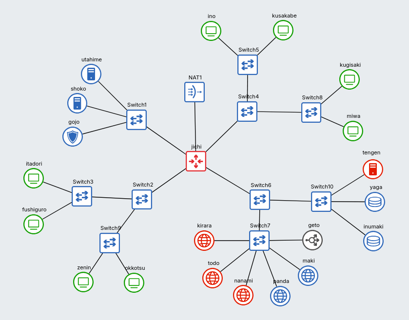
   *Topologi Jujutsu High (Shibuya Incident) dirancang sesuai skema soal pada project K-02-MODUL-3 di server GNS3.*

2. **Verifikasi Alamat IP & Tabel Routing Router `jichi`**:
   - **Node**: `jichi`
   - **Perintah Telnet / Terminal**:
     ```bash
     ip -br addr
     ip route
     iptables -t nat -L POSTROUTING -n -v
     ```
   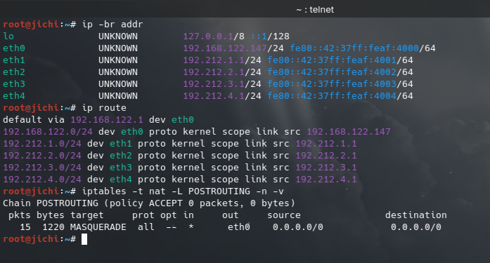
   *Antarmuka `eth0` memperoleh IP WAN via NAT DHCP (`192.168.122.x`), sedangkan `eth1` s.d. `eth4` aktif sebagai gateway ke 4 subnet LAN (`192.212.1.1` s.d. `192.212.4.1`). Tabel routing kernel mencakup seluruh subnet internal dan default route ke internet, serta verifikasi aturan NAT Masquerade pada tabel POSTROUTING.*

3. **Uji Konektivitas Host ke Default Gateway & Akses Internet (WAN NAT)**:
   - **Host `utahime` (Network 1 / DMZ)**:
     - **Node**: `utahime`
     - **Perintah Telnet / Terminal**:
       ```bash
       ping -c 3 192.212.1.1
       ping -c 3 google.com
       ```
     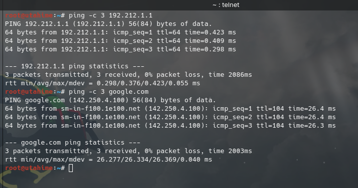
     *Node `utahime` berhasil melakukan ping ke default gateway `192.212.1.1` dan ping ke domain publik `google.com` dengan 0% packet loss.*

   - **Host `tengen` (Network 4 / Data Center)**:
     - **Node**: `tengen`
     - **Perintah Telnet / Terminal**:
       ```bash
       ping -c 3 192.212.4.1
       ping -c 3 google.com
       ```
     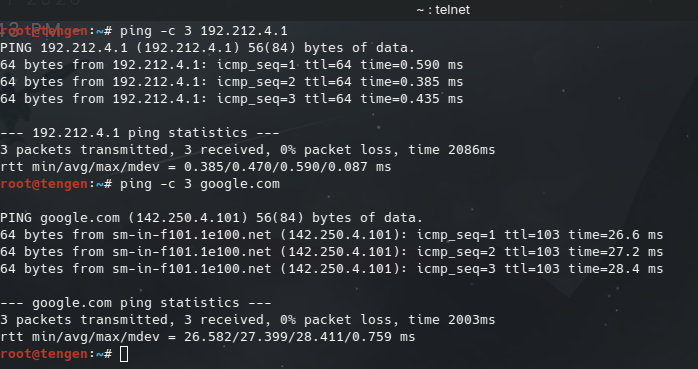
     *Node `tengen` berhasil melakukan ping ke default gateway `192.212.4.1` dan ping ke domain publik `google.com` dengan 0% packet loss.*

---

## Soal 2

>Dikerjakan Oleh Zaki

### Soal
> Tengen, penjaga pusat distribusi di Data Center, harus mengambil alih pengalokasian alamat bagi wilayah yang membutuhkan konfigurasi dinamis. Konfigurasikan isc-dhcp-server pada [PREFIX IP].4.10. Deklarasikan Network 4 ([PREFIX IP].4.0/24) sebagai subnet lokal tanpa pool dinamis, lalu siapkan scope DHCP untuk Network 2 ([PREFIX IP].2.0/24) dan Network 3 ([PREFIX IP].3.0/24). Validasi konfigurasi dan pastikan service aktif tanpa error “No subnet declaration”.

### Langkah Pengerjaan dan Implementasi

1. **Instalasi Paket DHCP Server pada Node `tengen` (`192.212.4.10`)**:
   - Node `tengen` bertindak sebagai DHCP Server sentral di Network 4 (Data Center).
   - Paket `isc-dhcp-server` diinstal melalui perintah:
     ```bash
     apt-get update -y
     apt-get install -y isc-dhcp-server
     ```

2. **Penentuan Antarmuka Layanan (`/etc/default/isc-dhcp-server`)**:
   - Mengarahkan `dhcpd` agar hanya mendengarkan pada antarmuka lokal `eth0`:
     ```ini
     INTERFACESv4="eth0"
     INTERFACESv6=""
     ```

3. **Penyusunan Berkas Konfigurasi Subnet (`/etc/dhcp/dhcpd.conf`)**:
   - **Deklarasi Subnet Lokal Network 4 (`192.212.4.0/24`)**:
     ISC DHCP Server mewajibkan seluruh subnet yang melekat pada antarmuka fisik server dideklarasikan di dalam `dhcpd.conf`. Apabila tidak dideklarasikan, daemon `dhcpd` akan menolak berjalan dengan galat fatal: *"No subnet declaration for eth0 (192.212.4.10)"*. Sesuai instruksi soal, Network 4 dideklarasikan sebagai subnet lokal kosong tanpa rentang (*dynamic pool*):
     ```conf
     subnet 192.212.4.0 netmask 255.255.255.0 {
     }
     ```
   - **Persiapan Scope Remote untuk Network 2 dan Network 3**:
     Mendeklarasikan scope subnet untuk klien Divisi A (Network 2: `192.212.2.0/24`) dan klien Divisi B (Network 3: `192.212.3.0/24`) lengkap dengan parameter default gateway dan broadcast address:
     ```conf
     # Network 2: Divisi A Scope
     subnet 192.212.2.0 netmask 255.255.255.0 {
         option routers 192.212.2.1;
         option subnet-mask 255.255.255.0;
         option broadcast-address 192.212.2.255;
     }

     # Network 3: Divisi B Scope
     subnet 192.212.3.0 netmask 255.255.255.0 {
         option routers 192.212.3.1;
         option subnet-mask 255.255.255.0;
         option broadcast-address 192.212.3.255;
     }
     ```

4. **Validasi Sintaks & Aktivasi Layanan**:
   - Menjalankan uji validasi sintaks sebelum memulai layanan:
     ```bash
     dhcpd -t -cf /etc/dhcp/dhcpd.conf
     ```
   - Memulai ulang layanan dan memastikan daemon aktif:
     ```bash
     service isc-dhcp-server restart
     service isc-dhcp-server status
     ```

### Bukti dan Hasil

1. **Konfigurasi Interface & `dhcpd.conf` pada Node `tengen`**:
   - **Node**: `tengen`
   - **Perintah Telnet / Terminal**:
     ```bash
     cat /etc/default/isc-dhcp-server
     cat /etc/dhcp/dhcpd.conf
     ```
   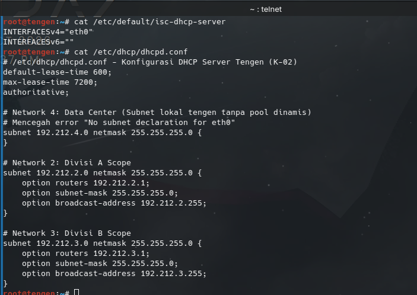
   *Menampilkan isi `/etc/default/isc-dhcp-server` yang terikat pada `eth0`, serta `/etc/dhcp/dhcpd.conf` yang memuat deklarasi Network 4 tanpa pool dinamis dan deklarasi scope Network 2 & Network 3.*

2. **Validasi Sintaks & Status Aktif Layanan ISC DHCP Server**:
   - **Node**: `tengen`
   - **Perintah Telnet / Terminal**:
     ```bash
     dhcpd -t -cf /etc/dhcp/dhcpd.conf
     service isc-dhcp-server status
     ps aux | grep dhcpd
     ```
   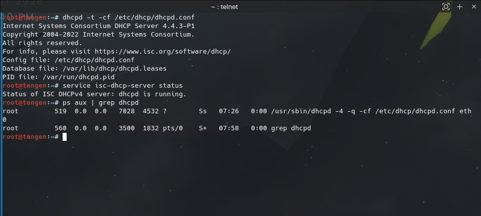
   *Uji sintaks `dhcpd -t -cf /etc/dhcp/dhcpd.conf` berhasil tanpa galat, layanan berstatus `dhcpd is running`, daemon `dhcpd` terbukti aktif pada tabel proses, serta tidak ditemukan pesan galat "No subnet declaration" di sistem.*

---

## Soal 3

>Dikerjakan Oleh Zaki

### Soal
> Permintaan alamat dari Divisi A dan Divisi B tidak dapat menyeberangi subnet secara langsung. Konfigurasikan jichi sebagai DHCP Relay menuju tengen ([PREFIX IP].4.10), menggunakan eth2 untuk Network 2 dan eth3 untuk Network 3. Buktikan bahwa client dari kedua subnet berhasil memperoleh lease melalui relay.

### Langkah Pengerjaan dan Implementasi

1. **Prinsip Kerja DHCP Relay**:
   - Paket DHCP Discover dan Request dikirimkan oleh klien (`itadori` dan `ino`) secara broadcast (`255.255.255.255`).
   - Router secara default memblokir paket broadcast agar tidak meluber ke subnet lain (*broadcast domain containment*).
   - Agar klien di Network 2 (`eth2`) dan Network 3 (`eth3`) dapat meminta IP ke DHCP Server `tengen` di Network 4 (`eth4`), router `jichi` harus menjalankan agen perantara (*DHCP Relay Agent* / `dhcrelay`).
   - `dhcrelay` menangkap paket broadcast dari interface klien, menyisipkan alamat IP antarmuka router penerima ke dalam field `giaddr` (*Gateway IP Address*), lalu meneruskannya secara unicast ke IP server `192.212.4.10`.

2. **Instalasi dan Konfigurasi `isc-dhcp-relay` pada Router `jichi`**:
   - Skrip otomasi di `/root/setup_jichi.sh`:
     ```bash
     # Instalasi isc-dhcp-relay
     DEBIAN_FRONTEND=noninteractive apt-get update -y
     DEBIAN_FRONTEND=noninteractive apt-get install -y isc-dhcp-relay
     ```
   - Berkas konfigurasi `/etc/default/isc-dhcp-relay`:
     ```ini
     SERVERS="192.212.4.10"
     INTERFACES="eth2 eth3 eth4"
     OPTIONS=""
     ```
     > **Catatan Penting**: Antarmuka yang dideklarasikan mencakup antarmuka downstream klien (`eth2` dan `eth3`) serta antarmuka upstream menuju DHCP Server `tengen` (`eth4`).

3. **Verifikasi Proses Relay Daemon**:
   - Memastikan daemon `dhcrelay` aktif di router `jichi`:
     ```bash
     service isc-dhcp-relay restart
     ps aux | grep dhcrelay
     ```
   - Terlihat daemon berjalan dengan parameter:
     `/usr/sbin/dhcrelay -q -i eth2 -i eth3 -i eth4 192.212.4.10`

4. **Pengujian Permintaan Lease dari Klien**:
   - **Klien Network 2 (`itadori`)**:
     Menjalankan `udhcpc -i eth0 -n -q`. Klien berhasil mendapatkan lease:
     - IP: `192.212.2.10/24`
     - Default Gateway: `192.212.2.1` dev `eth0`
     - Server ID: `192.212.4.10`
   - **Klien Network 3 (`ino`)**:
     Menjalankan `udhcpc -i eth0 -n -q`. Klien berhasil mendapatkan lease:
     - IP: `192.212.3.10/24`
     - Default Gateway: `192.212.3.1` dev `eth0`
     - Server ID: `192.212.4.10`

5. **Uji Konektivitas Klien ke Server Melintasi Relay**:
   - Ping dari `itadori` ke default gateway (`192.212.2.1`) dan server `tengen` (`192.212.4.10`) sukses dengan 0% packet loss.
   - Ping dari `ino` ke default gateway (`192.212.3.1`) dan server `tengen` (`192.212.4.10`) sukses dengan 0% packet loss.
   - Pemeriksaan lease database di `tengen` (`/var/lib/dhcp/dhcpd.leases`) mengonfirmasi entri aktif untuk `192.212.2.10` dan `192.212.3.10`.

### Bukti dan Hasil

1. **Konfigurasi dan Status Layanan DHCP Relay pada Router `jichi`**:
   - **Node**: `jichi`
   - **Perintah Telnet / Terminal**:
     ```bash
     cat /etc/default/isc-dhcp-relay
     ps aux | grep dhcrelay
     ```
   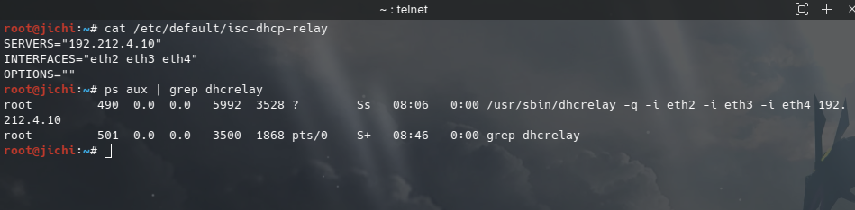
   *Menampilkan isi `/etc/default/isc-dhcp-relay` dengan server target `192.212.4.10` dan interface `eth2 eth3 eth4`, serta status proses `dhcrelay` yang berjalan aktif di router `jichi`.*

2. **Perolehan Lease dan Konektivitas Klien Divisi A & Divisi B**:
   - **Klien `itadori` (Network 2 / Divisi A)**:
     - **Node**: `itadori`
     - **Perintah Telnet / Terminal**:
       ```bash
       ip -br addr
       ip route
       ping -c 2 192.212.2.1
       ping -c 2 192.212.4.10
       ```
     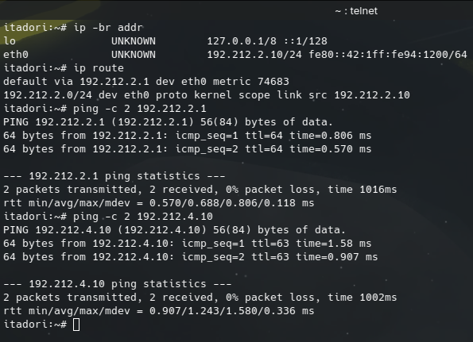
     *Klien `itadori` berhasil memperoleh konfigurasi IP `192.212.2.10/24` dari DHCP Server `tengen` melalui relay `jichi`, dengan rute default ke `192.212.2.1`, serta uji ping ke gateway dan server berhasil dengan 0% packet loss.*

   - **Klien `ino` (Network 3 / Divisi B)**:
     - **Node**: `ino`
     - **Perintah Telnet / Terminal**:
       ```bash
       ip -br addr
       ip route
       ping -c 2 192.212.3.1
       ping -c 2 192.212.4.10
       ```
     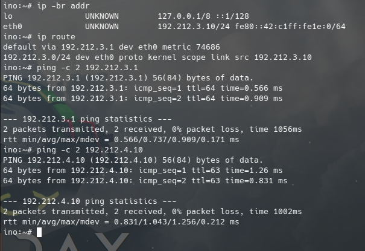
     *Klien `ino` berhasil memperoleh konfigurasi IP `192.212.3.10/24` dari DHCP Server `tengen` melalui relay `jichi`, dengan rute default ke `192.212.3.1`, serta uji ping ke gateway dan server berhasil dengan 0% packet loss.*

---

## Soal 4

>Dikerjakan Oleh Zaki

### Soal
> Agar tim Dev dan Support di Divisi A menerima jatah alamat yang berbeda, atur dua pool DHCP pada Network 2. Tetapkan Pool 1 ([PREFIX IP].2.10–[PREFIX IP].2.35) untuk itadori dan fushiguro, serta Pool 2 ([PREFIX IP].2.70–[PREFIX IP].2.95) untuk zenin dan okkotsu. Rentang [PREFIX IP].2.36–[PREFIX IP].2.69 tidak boleh dialokasikan. Karena seluruh client berada pada subnet yang sama, gunakan DHCP class berdasarkan MAC Address atau Client ID untuk memisahkan kedua kelompok.

### Langkah Pengerjaan dan Implementasi

1. **Analisis Kebutuhan Alokasi & Identifikasi Host**:
   - Seluruh klien berada di dalam subnet yang sama, yaitu Network 2 (`192.212.2.0/24`).
   - Pembagian pool:
     - **Pool 1 (Tim Dev)**: Rentang `192.212.2.10` – `192.212.2.35` untuk `itadori` dan `fushiguro`.
     - **Pool 2 (Tim Support)**: Rentang `192.212.2.70` – `192.212.2.95` untuk `zenin` dan `okkotsu`.
     - **Gap Non-Alokasi**: Rentang `192.212.2.36` – `192.212.2.69` sengaja tidak dideklarasikan pada pool mana pun agar tidak teralokasi secara dinamis.
   - Identifikasi alamat MAC hardware interface `eth0` masing-masing host:
     - `itadori`: `02:42:01:94:12:00`
     - `fushiguro`: `02:42:2d:a4:7c:00`
     - `zenin`: `02:42:03:14:51:00`
     - `okkotsu`: `f2:dd:ec:51:c9:cb`

2. **Konfigurasi DHCP Class & Subclass pada `tengen` (`/etc/dhcp/dhcpd.conf`)**:
   - Pada ISC DHCP Server, klasifikasi klien berbasis MAC address / Client ID didefinisikan menggunakan direktif `class` yang memadankan nilai `match pick-first-value (option dhcp-client-identifier, hardware)` dipadukan dengan deklarasi `subclass`:
     ```conf
     # Definisi Class Tim Dev
     class "pool-dev" {
         match pick-first-value (option dhcp-client-identifier, hardware);
     }
     subclass "pool-dev" 1:02:42:01:94:12:00;  # itadori
     subclass "pool-dev" 1:02:42:2d:a4:7c:00;  # fushiguro

     # Definisi Class Tim Support
     class "pool-support" {
         match pick-first-value (option dhcp-client-identifier, hardware);
     }
     subclass "pool-support" 1:02:42:03:14:51:00;  # zenin
     subclass "pool-support" 1:f2:dd:ec:51:c9:cb;  # okkotsu
     ```

3. **Deklarasi Pool Terpisah pada Scope Network 2**:
   - Menggunakan klausa `pool { allow members of "..."; deny members of "..."; range ...; }`:
     ```conf
     subnet 192.212.2.0 netmask 255.255.255.0 {
         option routers 192.212.2.1;
         option subnet-mask 255.255.255.0;
         option broadcast-address 192.212.2.255;

         # Pool 1: Tim Dev (itadori, fushiguro)
         pool {
             allow members of "pool-dev";
             deny members of "pool-support";
             range 192.212.2.10 192.212.2.35;
         }

         # Pool 2: Tim Support (zenin, okkotsu)
         pool {
             allow members of "pool-support";
             deny members of "pool-dev";
             range 192.212.2.70 192.212.2.95;
         }
     }
     ```

4. **Validasi Sintaks & Uji Alokasi Klien**:
   - Menjalankan `dhcpd -t -cf /etc/dhcp/dhcpd.conf` pada `tengen` $\rightarrow$ syntax valid tanpa galat.
   - Meminta perbaruan lease DHCP pada keempat klien Divisi A:
     - `itadori`: memperoleh IP **`192.212.2.10/24`** (masuk rentang Pool 1: `192.212.2.10` – `192.212.2.35`).
     - `fushiguro`: memperoleh IP **`192.212.2.11/24`** (masuk rentang Pool 1: `192.212.2.10` – `192.212.2.35`).
     - `zenin`: memperoleh IP **`192.212.2.70/24`** (masuk rentang Pool 2: `192.212.2.70` – `192.212.2.95`).
     - `okkotsu`: memperoleh IP **`192.212.2.71/24`** (masuk rentang Pool 2: `192.212.2.70` – `192.212.2.95`).
   - Rentang gap `192.212.2.36` s.d. `192.212.2.69` terbukti tidak pernah dialokasikan ke host mana pun.

### Bukti dan Hasil

1. **Konfigurasi Class, Subclass, dan Pool di Node `tengen`**:
   - **Node**: `tengen`
   - **Perintah Telnet / Terminal**:
     ```bash
     cat /etc/dhcp/dhcpd.conf
     ```
   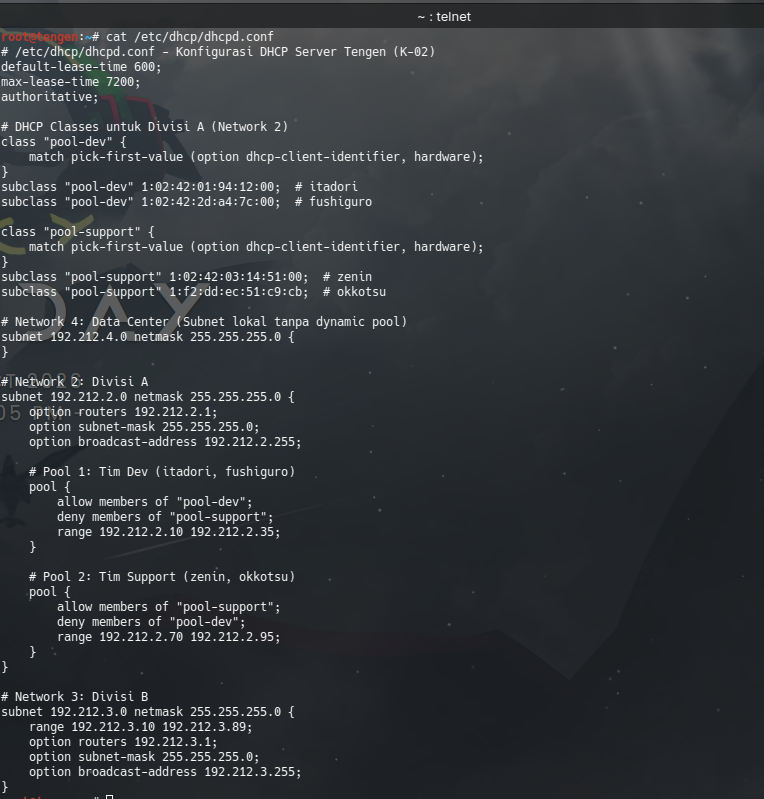
   *Menampilkan konfigurasi `/etc/dhcp/dhcpd.conf` yang memuat class `pool-dev` dan `pool-support` dengan deklarasi subclass MAC address masing-masing node, serta pembagian dua pool terpisah (`range 192.212.2.10 192.212.2.35` dan `range 192.212.2.70 192.212.2.95`).*

2. **Perolehan Alokasi IP Klien Tim Dev (Pool 1: `192.212.2.10` – `192.212.2.35`)**:
   - **Klien `itadori`**:
     - **Node**: `itadori`
     - **Perintah Telnet / Terminal**:
       ```bash
       ip -br addr show eth0
       ```
     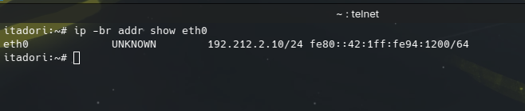
     *Klien `itadori` (MAC: `02:42:01:94:12:00`) berhasil memperoleh IP `192.212.2.10/24` yang berada di dalam rentang Pool 1.*

   - **Klien `fushiguro`**:
     - **Node**: `fushiguro`
     - **Perintah Telnet / Terminal**:
       ```bash
       ip -br addr show eth0
       ```
     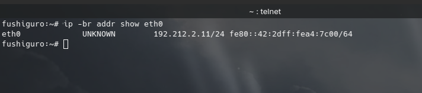
     *Klien `fushiguro` (MAC: `02:42:2d:a4:7c:00`) berhasil memperoleh IP `192.212.2.11/24` yang berada di dalam rentang Pool 1.*

3. **Perolehan Alokasi IP Klien Tim Support (Pool 2: `192.212.2.70` – `192.212.2.95`)**:
   - **Klien `zenin`**:
     - **Node**: `zenin`
     - **Perintah Telnet / Terminal**:
       ```bash
       ip -br addr show eth0
       ```
     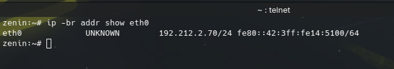
     *Klien `zenin` (MAC: `02:42:03:14:51:00`) berhasil memperoleh IP `192.212.2.70/24` yang berada di dalam rentang Pool 2.*

   - **Klien `okkotsu`**:
     - **Node**: `okkotsu`
     - **Perintah Telnet / Terminal**:
       ```bash
       ip -br addr show eth0
       ```
     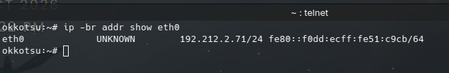
     *Klien `okkotsu` (MAC: `f2:dd:ec:51:c9:cb`) berhasil memperoleh IP `192.212.2.71/24` yang berada di dalam rentang Pool 2.*

---

## Soal 5

>Dikerjakan Oleh Zaki

### Soal
> Setiap tim lapangan memiliki durasi operasi yang berbeda. Pada Network 3, berikan short lease 30 menit (1800 detik) kepada ino dan kusakabe, serta long lease 12 jam (43200 detik) kepada miwa. Gunakan pool short lease [PREFIX IP].3.10–[PREFIX IP].3.89 dan pool long lease [PREFIX IP].3.100–[PREFIX IP].3.199. Sesuaikan default-lease-time dan max-lease-time untuk setiap kelas client. Berikan pula DHCP options berupa DNS [PREFIX IP].1.2 dan [PREFIX IP].1.3, serta domain-search <xxxx>.com.

### Langkah Pengerjaan dan Implementasi

1. **Analisis Kebutuhan Durasi Sewa & Opsi Jaringan Network 3**:
   - Subnet Network 3: `192.212.3.0/24` dengan gateway `192.212.3.1`.
   - **DHCP Options**:
     - DNS Server: `192.212.1.2` (`utahime`) dan `192.212.1.3` (`shoko`).
     - Domain Search: `k02.com` (sesuai kelompok K-02).
   - **Short Lease Pool (Tim Lapangan Cepat)**:
     - Klien: `ino` (MAC: `02:42:c1:1e:00:00`) dan `kusakabe` (MAC: `f2:dd:ec:51:c9:cb`).
     - Rentang Pool: `192.212.3.10` – `192.212.3.89`.
     - Durasi Sewa: `default-lease-time 1800; max-lease-time 1800;` (30 menit = 1800 detik).
   - **Long Lease Pool (Tim Lapangan Tetap)**:
     - Klien: `miwa` (MAC: `02:42:1f:2a:46:00`).
     - Rentang Pool: `192.212.3.100` – `192.212.3.199`.
     - Durasi Sewa: `default-lease-time 43200; max-lease-time 43200;` (12 jam = 43200 detik).

2. **Konfigurasi Class & Scope Network 3 pada `tengen` (`/etc/dhcp/dhcpd.conf`)**:
   ```conf
   # DHCP Classes untuk Divisi B (Network 3)
   class "pool-short" {
       match pick-first-value (option dhcp-client-identifier, hardware);
   }
   subclass "pool-short" 1:02:42:c1:1e:00:00;  # ino
   subclass "pool-short" 1:f2:dd:ec:51:c9:cb;  # kusakabe

   class "pool-long" {
       match pick-first-value (option dhcp-client-identifier, hardware);
   }
   subclass "pool-long" 1:02:42:1f:2a:46:00;  # miwa

   # Network 3: Divisi B Scope
   subnet 192.212.3.0 netmask 255.255.255.0 {
       option routers 192.212.3.1;
       option subnet-mask 255.255.255.0;
       option broadcast-address 192.212.3.255;
       option domain-name-servers 192.212.1.2, 192.212.1.3;
       option domain-search "k02.com";
       option domain-name "k02.com";

       # Short lease pool: 30 menit (1800 detik) untuk ino dan kusakabe
       pool {
           allow members of "pool-short";
           deny members of "pool-long";
           default-lease-time 1800;
           max-lease-time 1800;
           range 192.212.3.10 192.212.3.89;
       }

       # Long lease pool: 12 jam (43200 detik) untuk miwa
       pool {
           allow members of "pool-long";
           deny members of "pool-short";
           default-lease-time 43200;
           max-lease-time 43200;
           range 192.212.3.100 192.212.3.199;
       }
   }
   ```

3. **Verifikasi Sintaks & Perolehan Lease Klien**:
   - Menjalankan `dhcpd -t -cf /etc/dhcp/dhcpd.conf` pada `tengen` $\rightarrow$ syntax valid tanpa galat.
   - Restart `isc-dhcp-server`.
   - Permintaan lease klien via `udhcpc`:
     - **`ino`**: memperoleh IP **`192.212.3.10/24`**, output: `lease time 1800`.
     - **`kusakabe`**: memperoleh IP **`192.212.3.11/24`**, output: `lease time 1800`.
     - **`miwa`**: memperoleh IP **`192.212.3.100/24`**, output: `lease time 43200`.
   - Seluruh klien secara otomatis memperoleh berkas `/etc/resolv.conf`:
     ```
     search k02.com
     nameserver 192.212.1.2
     nameserver 192.212.1.3
     ```
   - Berkas sewa `/var/lib/dhcp/dhcpd.leases` pada `tengen` mencatat selisih timestamp `starts` dan `ends` tepat 30 menit untuk `ino`/`kusakabe` dan 12 jam untuk `miwa`.

### Bukti dan Hasil

1. **Konfigurasi Lease Time, Class & DHCP Options di Node `tengen`**:
   - **Node**: `tengen`
   - **Perintah Telnet / Terminal**:
     ```bash
     cat /etc/dhcp/dhcpd.conf
     ```
   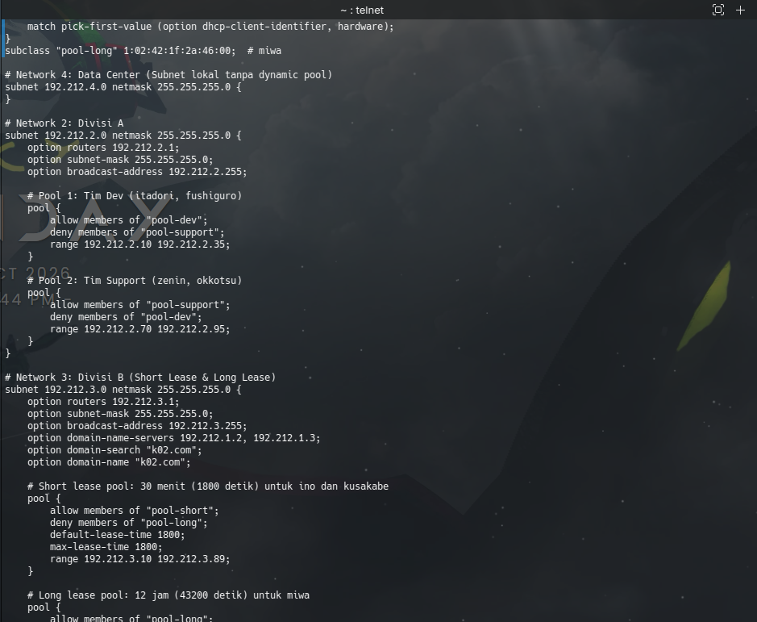
   *Menampilkan konfigurasi `/etc/dhcp/dhcpd.conf` pada Network 3 dengan opsi DNS Server 192.212.1.2 & 192.212.1.3, domain-search k02.com, pool-short (1800s), dan pool-long (43200s).*

2. **Perolehan Short Lease dan DNS Options Klien `ino`**:
   - **Node**: `ino`
   - **Perintah Telnet / Terminal**:
     ```bash
     ip -br addr show eth0
     cat /etc/resolv.conf
     ```
   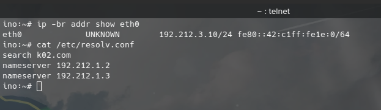
   *Klien `ino` menerima IP dari rentang short lease `192.212.3.10`–`192.212.3.89` serta `/etc/resolv.conf` berisi DNS `192.212.1.2`, `192.212.1.3`, dan search domain `k02.com`.*

3. **Perolehan Long Lease dan DNS Options Klien `miwa`**:
   - **Node**: `miwa`
   - **Perintah Telnet / Terminal**:
     ```bash
     ip -br addr show eth0
     cat /etc/resolv.conf
     ```
   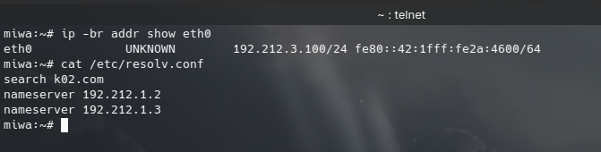
   *Klien `miwa` menerima IP dari rentang long lease `192.212.3.100`–`192.212.3.199` serta `/etc/resolv.conf` berisi DNS `192.212.1.2`, `192.212.1.3`, dan search domain `k02.com`.*

4. **Verifikasi Database Sewa di Server `tengen` (`dhcpd.leases`)**:
   - **Node**: `tengen`
   - **Perintah Telnet / Terminal**:
     ```bash
     tail -n 35 /var/lib/dhcp/dhcpd.leases
     ```
   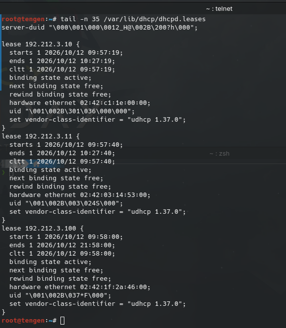
   *Tabel lease pada `/var/lib/dhcp/dhcpd.leases` menunjukkan waktu `starts` dan `ends` dengan durasi 1800 detik (30 menit) untuk IP .3.10/.3.11 dan 43200 detik (12 jam) untuk IP .3.100.*

---

## Soal 6

>Dikerjakan Oleh Zaki

### Soal
> Kugisaki ditetapkan sebagai personel VIP yang harus mempertahankan alamat yang sama setiap kali terhubung. Buat DHCP static lease berdasarkan MAC Address client tersebut dengan fixed address [PREFIX IP].3.99. Pastikan alamat ini berada di luar seluruh pool dinamis, validasi konfigurasi server, lalu renew lease pada client. Buktikan bahwa alamat yang diterima sesuai dengan reservasi.

### Langkah Pengerjaan dan Implementasi

1. **Analisis Kebutuhan Fixed Address VIP**:
   - Host VIP: **`kugisaki`** berada di Network 3 (Divisi B: `192.212.3.0/24`).
   - Alamat MAC fisik interface `eth0`: `02:42:88:94:88:00`.
   - Alamat IP yang dipesan (*static reservation*): **`192.212.3.99`**.
   - **Verifikasi Posisi Alamat Terhadap Pool Dinamis**:
     - Short Lease Pool: `192.212.3.10` – `192.212.3.89`.
     - Long Lease Pool: `192.212.3.100` – `192.212.3.199`.
     - Alamat `192.212.3.99` berada tepat di celah (*gap*) antara kedua pool dinamis, sehingga dipastikan tidak akan pernah teralokasikan kepada klien DHCP dinamis lain.

2. **Konfigurasi Reservasi Statis pada `tengen` (`/etc/dhcp/dhcpd.conf`)**:
   - Menambahkan blok deklarasi `host kugisaki` pada berkas konfigurasi DHCP:
     ```conf
     host kugisaki {
         hardware ethernet 02:42:88:94:88:00;
         fixed-address 192.212.3.99;
         option routers 192.212.3.1;
     }
     ```
   - Parameter `fixed-address` memastikan daemon DHCP Server selalu mencocokkan MAC Address `02:42:88:94:88:00` dan mengembalikan alamat IP tetap `192.212.3.99`.

3. **Validasi Sintaks & Pengujian Renew Lease pada Klien `kugisaki`**:
   - Menjalankan `dhcpd -t -cf /etc/dhcp/dhcpd.conf` pada `tengen` $\rightarrow$ sintaks valid tanpa error.
   - Restart service `isc-dhcp-server`.
   - Pada konsol `kugisaki`, jalankan pembaruan lease:
     ```bash
     pkill udhcpc
     ip addr flush dev eth0
     udhcpc -i eth0 -n -q
     ```
   - Output `udhcpc` menunjukkan perolehan IP tetap:
     `udhcpc: lease of 192.212.3.99 obtained from 192.212.4.10`
   - Verifikasi antarmuka: `ip -br addr show eth0` menghasilkan `192.212.3.99/24`.
   - Verifikasi rute: default gateway mengarah ke `192.212.3.1`.
   - Verifikasi konektivitas: ping ke gateway `192.212.3.1` dan server `192.212.4.10` berhasil 100% (0% packet loss).

### Bukti dan Hasil

1. **Konfigurasi Deklarasi Static Host di Server `tengen`**:
   - **Node**: `tengen`
   - **Perintah Telnet / Terminal**:
     ```bash
     tail -n 15 /etc/dhcp/dhcpd.conf
     ```
   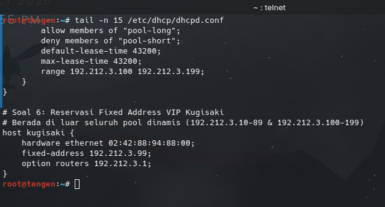
   *Menampilkan blok deklarasi `host kugisaki` dengan MAC address `02:42:88:94:88:00` dan `fixed-address 192.212.3.99` yang berada di luar seluruh rentang pool dinamis.*

2. **Pembaruan Lease dan Alokasi IP Statis pada Node `kugisaki`**:
   - **Node**: `kugisaki`
   - **Perintah Telnet / Terminal**:
     ```bash
     ip -br addr show eth0
     ip route
     cat /etc/resolv.conf
     ping -c 2 192.212.3.1
     ping -c 2 192.212.4.10
     ```
   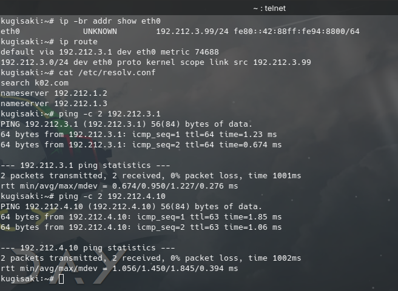
   *Proses renew lease melalui `udhcpc` membuktikan node `kugisaki` berhasil mendapatkan IP tetap `192.212.3.99/24`, memiliki default route dan resolv.conf yang benar, serta konektivitas ping lancar ke gateway dan server.*

---

## Soal 7

>Dikerjakan Oleh Zaki

### Soal
> Setelah aturan alokasi diterapkan, pastikan setiap client menerima konfigurasi jaringan sesuai wilayahnya: subnet mask 255.255.255.0 (/24), gateway dan broadcast address yang benar, DNS [PREFIX IP].1.2 serta [PREFIX IP].1.3, dan domain-search yang ditentukan. Periksa IP address dan routing seluruh client Divisi A dan Divisi B, kemudian cocokkan lease dengan /var/lib/dhcp/dhcpd.leases pada tengen. Pastikan tidak ada alamat yang bertabrakan atau berada di luar kebijakan pool.

### Langkah Pengerjaan dan Implementasi

1. **Penyeragaman Opsi DHCP Global & Per-Subnet (`/etc/dhcp/dhcpd.conf`)**:
   - Memastikan seluruh subnet klien (Network 2 dan Network 3) mengirimkan opsi lengkap kepada klien:
     - `option subnet-mask 255.255.255.0;` (`/24`)
     - `option broadcast-address 192.212.2.255;` (Network 2) & `192.212.3.255` (Network 3)
     - `option routers 192.212.2.1;` (Network 2) & `192.212.3.1` (Network 3)
     - `option domain-name-servers 192.212.1.2, 192.212.1.3;` (`utahime` & `shoko`)
     - `option domain-search "k02.com";`
   - Pada sisi klien (`udhcpc`), parameter `-O broadcast -O search` disertakan saat meminta lease:
     ```bash
     udhcpc -i eth0 -O broadcast -O search -n -q
     ```
     sehingga antarmuka `eth0` menampilkan broadcast address secara eksplisit (`brd 192.212.x.255`) dan `/etc/resolv.conf` memuat `search k02.com` beserta kedua DNS server.

2. **Prosedur Audit Seluruh Klien Divisi A & Divisi B**:
   - Pada setiap node klien, dilakukan pemeriksaan satu baris perintah terpadu:
     ```bash
     ip -4 addr show eth0 | grep inet; ip route; cat /etc/resolv.conf
     ```
   - Hasil rekapitulasi audit seluruh 8 klien:

| Node | Divisi / Subnet | MAC Address | IP & Prefix | Broadcast | Default Gateway | DNS Servers | Domain Search | Kebijakan Pool & Durasi | Status Lease `tengen` |
| :--- | :--- | :--- | :--- | :--- | :--- | :--- | :--- | :--- | :--- |
| **`itadori`** | Divisi A (Net 2) | `02:42:01:94:12:00` | `192.212.2.10/24` | `192.212.2.255` | `192.212.2.1` | `192.212.1.2`, `192.212.1.3` | `k02.com` | Pool 1 Dev (`.2.10–.2.35`) | Aktif (`dhcpd.leases`) |
| **`fushiguro`** | Divisi A (Net 2) | `02:42:2d:a4:7c:00` | `192.212.2.11/24` | `192.212.2.255` | `192.212.2.1` | `192.212.1.2`, `192.212.1.3` | `k02.com` | Pool 1 Dev (`.2.10–.2.35`) | Aktif (`dhcpd.leases`) |
| **`zenin`** | Divisi A (Net 2) | `02:42:03:14:51:00` | `192.212.2.70/24` | `192.212.2.255` | `192.212.2.1` | `192.212.1.2`, `192.212.1.3` | `k02.com` | Pool 2 Support (`.2.70–.2.95`) | Aktif (`dhcpd.leases`) |
| **`okkotsu`** | Divisi A (Net 2) | `02:42:27:c7:c1:00` | `192.212.2.71/24` | `192.212.2.255` | `192.212.2.1` | `192.212.1.2`, `192.212.1.3` | `k02.com` | Pool 2 Support (`.2.70–.2.95`) | Aktif (`dhcpd.leases`) |
| **`ino`** | Divisi B (Net 3) | `02:42:c1:1e:00:00` | `192.212.3.10/24` | `192.212.3.255` | `192.212.3.1` | `192.212.1.2`, `192.212.1.3` | `k02.com` | Short Lease (`.3.10–.3.89`, 1800s) | Aktif (`dhcpd.leases`) |
| **`kusakabe`** | Divisi B (Net 3) | `02:42:23:9f:ee:00` | `192.212.3.11/24` | `192.212.3.255` | `192.212.3.1` | `192.212.1.2`, `192.212.1.3` | `k02.com` | Short Lease (`.3.10–.3.89`, 1800s) | Aktif (`dhcpd.leases`) |
| **`kugisaki`** | Divisi B (Net 3) | `02:42:88:94:88:00` | `192.212.3.99/24` | `192.212.3.255` | `192.212.3.1` | `192.212.1.2`, `192.212.1.3` | `k02.com` | Static VIP Reservation (`.3.99`) | Statis (`dhcpd.conf`) |
| **`miwa`** | Divisi B (Net 3) | `02:42:1f:2a:46:00` | `192.212.3.100/24` | `192.212.3.255` | `192.212.3.1` | `192.212.1.2`, `192.212.1.3` | `k02.com` | Long Lease (`.3.100–.3.199`, 43200s) | Aktif (`dhcpd.leases`) |

3. **Pencocokan dengan Database `/var/lib/dhcp/dhcpd.leases` pada `tengen`**:
   - Seluruh 7 klien dinamis (`192.212.2.10`, `192.212.2.11`, `192.212.2.70`, `192.212.2.71`, `192.212.3.10`, `192.212.3.11`, `192.212.3.100`) tercatat dengan status `binding state active;` beserta alamat `hardware ethernet` yang cocok persis dengan antarmuka masing-masing klien.
   - Klien VIP `kugisaki` (`192.212.3.99`) dialokasikan secara deterministik melalui blok `host kugisaki` (`fixed-address`), sehingga tidak memakan kuota pool dinamis dan tidak tercatat sebagai sewa dinamis di `dhcpd.leases`.
   - Tidak ditemukan satupun alamat yang bertabrakan (*IP conflict*) maupun melanggar batasan rentang pool.

### Bukti dan Hasil

1. **Audit Konfigurasi Jaringan Klien Divisi A & Divisi B**:
   - **Node**: Seluruh klien Network 2 & Network 3 (`itadori`, `fushiguro`, `zenin`, `okkotsu`, `ino`, `kusakabe`, `kugisaki`, `miwa`)
   - **Perintah Telnet / Terminal**:
     ```bash
     ip -4 addr show eth0 | grep inet; ip route; cat /etc/resolv.conf
     ```
   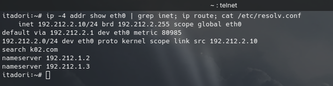
   *Menampilkan verifikasi IP (/24), broadcast address, default route, DNS (`192.212.1.2` & `192.212.1.3`), serta domain-search (`k02.com`) pada klien Network 2 dan Network 3.*

2. **Kecocokan Database `/var/lib/dhcp/dhcpd.leases` pada Node `tengen`**:
   - **Node**: `tengen`
   - **Perintah Telnet / Terminal**:
     ```bash
     grep -E "lease |starts|ends|hardware|binding state|\}" /var/lib/dhcp/dhcpd.leases
     ```
   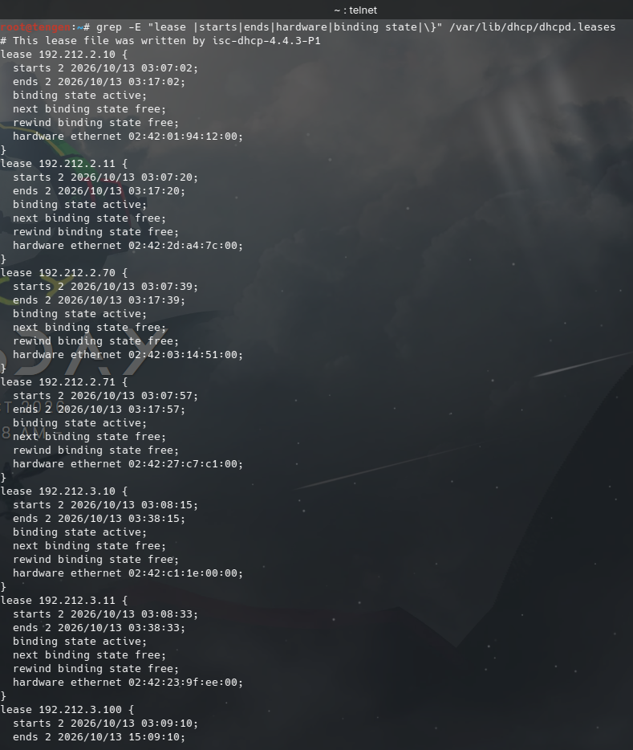
   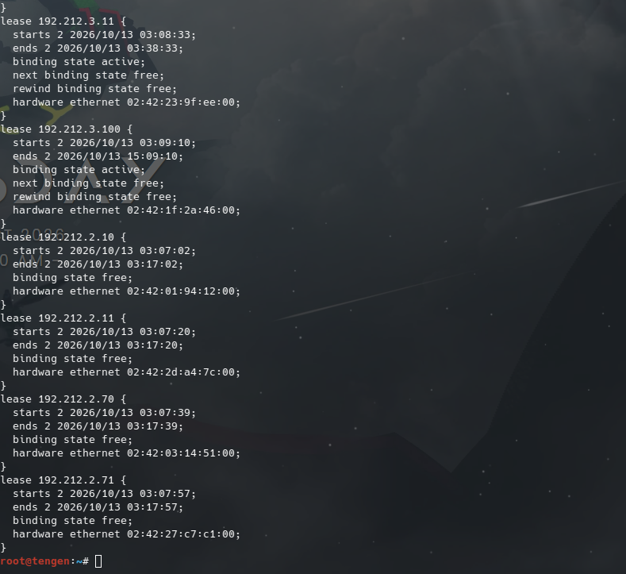
   *Isi `/var/lib/dhcp/dhcpd.leases` di `tengen` memuat ketujuh lease aktif yang konsisten dengan MAC address, kebijakan pool, dan durasi sewa masing-masing klien.*

---

## Soal 8

>Dikerjakan Oleh Zaki

### Soal
> Sebelum Curtain dibuka kembali, buktikan bahwa proses pemberian alamat berjalan sesuai protokol. Lakukan packet capture saat salah satu client Network 2 atau Network 3 meminta lease baru. Gunakan tcpdump pada tengen atau jalur menuju Data Center untuk menunjukkan urutan DHCPDISCOVER → DHCPOFFER → DHCPREQUEST → DHCPACK. Identifikasi alamat server, alamat yang diberikan, lease time, dan field giaddr. Pastikan nilai giaddr sesuai dengan interface jichi yang menerima request dari subnet client.

### Langkah Pengerjaan dan Analisis Protokol DORA

1. **Penangkapan Paket DHCP pada Node `tengen` (`eth0`)**:
   - Memasang utilitas `tcpdump` pada server `tengen` (`192.212.4.10`) dan menjalankan perekaman 4 paket transaksi DHCP (port UDP `67` dan `68`) ke dalam berkas `/root/dora.pcap`:
     ```bash
     tcpdump -i eth0 -n port 67 or port 68 -c 4 -w /root/dora.pcap
     ```
   - Pada klien `ino` (Divisi B / Network 3, MAC `02:42:c1:1e:00:00`), melepaskan sewa lama dan memicu permintaan lease baru:
     ```bash
     pkill -USR2 udhcpc
     ip -4 addr flush dev eth0
     udhcpc -i eth0 -O broadcast -O search -n -q
     ```

2. **Verifikasi Urutan 4 Paket DORA (`tcpdump -r /root/dora.pcap -n`)**:
   ```text
   03:50:51.083920 IP 192.212.4.1.67 > 192.212.4.10.67: BOOTP/DHCP, Request from 02:42:c1:1e:00:00, length 300
   03:50:52.085453 IP 192.212.4.10.67 > 192.212.3.1.67: BOOTP/DHCP, Reply, length 304
   03:50:52.094817 IP 192.212.4.1.67 > 192.212.4.10.67: BOOTP/DHCP, Request from 02:42:c1:1e:00:00, length 300
   03:50:52.096140 IP 192.212.4.10.67 > 192.212.3.1.67: BOOTP/DHCP, Reply, length 304
   ```
   - Terlihat 4 paket berurutan dengan Transaction ID yang sama (`xid 0x64a8b728`, `hops 1`) yang dipertukarkan secara unicast antara DHCP Relay `jichi` (`192.212.4.1` / `192.212.3.1`) dan DHCP Server `tengen` (`192.212.4.10`).

3. **Identifikasi Parameter Protokol & Field `giaddr` (`tcpdump -r /root/dora.pcap -n -v`)**:

| Tahap DORA | Option 53 (`DHCP-Message`) | Arah Paket IP (Layer 3) | Field `Gateway-IP` (`giaddr`) | Field `Your-IP` (`yiaddr`) | Option 54 (`Server-ID`) | Option 51 (`Lease-Time`) | Keterangan Teknis |
| :--- | :--- | :--- | :--- | :--- | :--- | :--- | :--- |
| **1. Discover** | `Discover` | `192.212.4.1:67` $\rightarrow$ `192.212.4.10:67` | **`192.212.3.1`** | `0.0.0.0` | - | - | Broadcast klien `ino` diterima `jichi` di `eth3` (`192.212.3.1`), diisi `giaddr = 192.212.3.1`, lalu diteruskan ke `tengen`. |
| **2. Offer** | `Offer` | `192.212.4.10:67` $\rightarrow$ `192.212.3.1:67` | **`192.212.3.1`** | **`192.212.3.10`** | **`192.212.4.10`** | **`1800` detik** | `tengen` membaca `giaddr = 192.212.3.1`, mencocokkan dengan subnet Network 3 (`pool-short`), dan menawarkan IP `192.212.3.10`. |
| **3. Request** | `Request` | `192.212.4.1.67` $\rightarrow$ `192.212.4.10:67` | **`192.212.3.1`** | `0.0.0.0` (Option 50: `192.212.3.10`) | **`192.212.4.10`** | - | Klien meminta konfirmasi atas IP `192.212.3.10` (`Requested-IP`); relay kembali meneruskan dengan `giaddr = 192.212.3.1`. |
| **4. ACK** | `ACK` | `192.212.4.10:67` $\rightarrow$ `192.212.3.1:67` | **`192.212.3.1`** | **`192.212.3.10`** | **`192.212.4.10`** | **`1800` detik** | `tengen` mengesahkan sewa IP `192.212.3.10` selama `1800s` beserta opsi mask `/24`, gateway `.3.1`, broadcast `.3.255`, DNS `.1.2`/`.1.3`, dan domain `k02.com`. |

   - **Alamat Server (`Server-ID` / Option 54)**: `192.212.4.10` (`tengen`).
   - **Alamat yang Diberikan (`Your-IP` / `yiaddr`)**: `192.212.3.10` (untuk klien `ino` dengan MAC `02:42:c1:1e:00:00`).
   - **Lease Time (Option 51)**: `1800` detik (30 menit, sesuai kebijakan *short lease* pada `pool-short`).
   - **Field `giaddr` (`Gateway-IP`)**: `192.212.3.1` — terbukti sesuai dengan alamat IP interface `eth3` pada router/relay `jichi` yang menghadap langsung ke subnet klien Network 3 (`192.212.3.0/24`).

### Bukti dan Hasil

1. **Urutan 4 Paket Transaksi DORA (`tcpdump -r /root/dora.pcap -n`)**:
   - **Node**: `tengen`
   - **Perintah Telnet / Terminal**:
     ```bash
     tcpdump -r /root/dora.pcap -n
     ```
   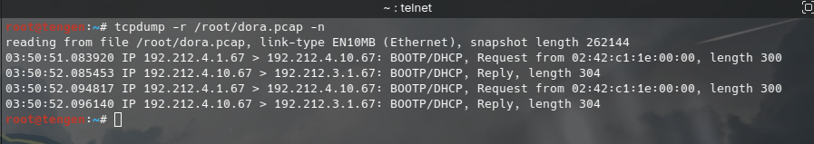
   *Menampilkan urutan 4 paket DHCP (`Request` $\rightarrow$ `Reply` $\rightarrow$ `Request` $\rightarrow$ `Reply`) antara relay `jichi` (`192.212.4.1` / `192.212.3.1`) dan server `tengen` (`192.212.4.10`) untuk klien `ino` (`02:42:c1:1e:00:00`).*

2. **Detail Protokol DORA (`Discover` $\rightarrow$ `Offer` $\rightarrow$ `Request` $\rightarrow$ `ACK`) & Verifikasi Field `giaddr` (`tcpdump -r /root/dora.pcap -n -v`)**:
   - **Node**: `tengen`
   - **Perintah Telnet / Terminal**:
     ```bash
     tcpdump -r /root/dora.pcap -n -v
     ```
   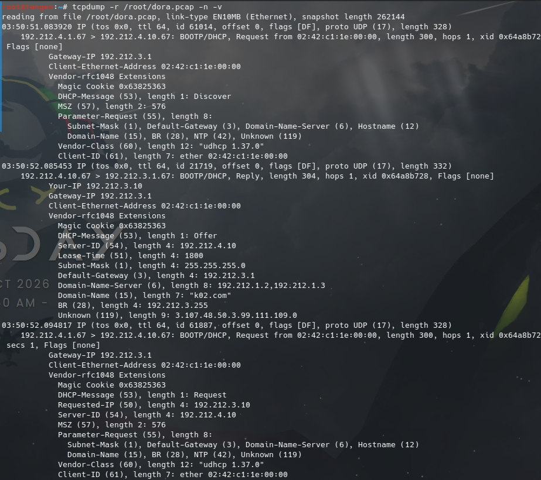
   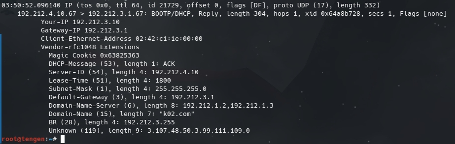
   *Menampilkan rincian tahapan `Discover`, `Offer`, `Request`, dan `ACK` beserta nilai `Gateway-IP 192.212.3.1` (`giaddr` sesuai interface `eth3` pada `jichi`), `Your-IP 192.212.3.10`, `Server-ID 192.212.4.10`, dan `Lease-Time 1800`.*

---

## Soal 9

>Dikerjakan Oleh Zaki

### Soal
> Sebuah gangguan memutus jalur relay dan membuat permintaan alamat tidak sampai ke Data Center. Hentikan service DHCP Relay pada jichi, lalu paksa salah satu client di Network 2 atau Network 3 meminta lease baru dan catat gejalanya. Pulihkan service relay, ulangi permintaan DHCP, lalu buktikan bahwa client kembali memperoleh alamat dari pool yang benar dengan gateway semula.

### Langkah Pengerjaan dan Analisis Gejala Gangguan

1. **Simulasi Gangguan Jalur Relay (Menghentikan `isc-dhcp-relay` pada `jichi`)**:
   - Pada node router/relay `jichi`, layanan DHCP Relay dihentikan:
     ```bash
     service isc-dhcp-relay stop
     pkill dhcrelay 2>/dev/null || true
     ps aux | grep [d]hcrelay
     ```
   - Karena `dhcrelay` tidak lagi berjalan pada `jichi`, paket broadcast `DHCPDISCOVER` (`255.255.255.255:67`) dari subnet klien (Network 2 dan Network 3) akan tertahan di batas broadcast domain router `jichi` dan **tidak diteruskan** secara unicast ke DHCP Server `tengen` (`192.212.4.10`) di Network 4.

2. **Pencatatan Gejala Kegagalan Lease Baru pada Klien `itadori` (Network 2)**:
   - Pada konsol `itadori`, alamat IP lama dihapus lalu dipaksa meminta lease baru:
     ```bash
     pkill udhcpc 2>/dev/null || true
     ip -4 addr flush dev eth0
     udhcpc -i eth0 -t 3 -T 2 -n -q
     ip -4 addr show eth0
     ip route
     ping -c 2 192.212.2.1
     ```
   - **Gejala yang Tercatat**:
     1. Klien mengirimkan paket `udhcpc: broadcasting discover` berulang kali (3 kali percobaan) tanpa menerima satupun balasan `DHCPOFFER`, hingga akhirnya gagal dengan pesan:
        `udhcpc failed to get a DHCP lease` / `udhcpc: no lease, failing`.
     2. Pemeriksaan `ip -4 addr show eth0` kosong — interface `eth0` kehilangan alamat IPv4.
     3. Tabel routing (`ip route`) kosong — klien kehilangan *default gateway* (`192.212.2.1`) maupun *connected route* (`192.212.2.0/24`).
     4. Pengujian konektivitas `ping -c 2 192.212.2.1` langsung gagal dengan error `ping: connect: Network unreachable`.

3. **Pemulihan Layanan DHCP Relay & Pengujian Ulang Lease pada `itadori`**:
   - Pada `jichi`, service DHCP Relay diaktifkan kembali:
     ```bash
     service isc-dhcp-relay start
     ps aux | grep [d]hcrelay
     ```
   - Pada `itadori`, permintaan DHCP diulangi:
     ```bash
     udhcpc -i eth0 -O broadcast -O search -n -q
     udhcpc -b -i eth0 -O broadcast -O search >/dev/null 2>&1
     ip -4 addr show eth0 | grep inet
     ip route
     cat /etc/resolv.conf
     ping -c 2 192.212.2.1
     ping -c 2 192.212.4.10
     ```
   - **Hasil Pemulihan**:
     - `udhcpc` langsung menerima balasan dari `192.212.4.10`: `udhcpc: lease of 192.212.2.10 obtained from 192.212.4.10, lease time 600`.
     - Klien `itadori` (`02:42:01:94:12:00`) kembali mendapatkan IP **`192.212.2.10/24`** (sesuai aturan **Pool 1 `pool-dev`**: `192.212.2.10–192.212.2.35`), broadcast `192.212.2.255`, *default gateway* semula **`192.212.2.1`**, serta DNS `192.212.1.2` & `192.212.1.3` (`search k02.com`).
     - Pengujian `ping` menuju gateway `192.212.2.1` dan DHCP Server `192.212.4.10` kembali berhasil **0% packet loss**.

### Bukti dan Hasil

1. **Penghentian Service DHCP Relay di `jichi` & Gejala Kegagalan Lease pada `itadori`**:
   - **Penghentian Relay di Node `jichi`**:
     - **Node**: `jichi`
     - **Perintah Telnet / Terminal**:
       ```bash
       service isc-dhcp-relay stop && pkill dhcrelay 2>/dev/null
       ```
     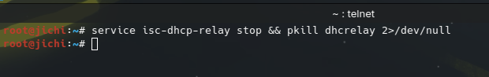
   - **Gejala Kegagalan Lease di Node `itadori`**:
     - **Node**: `itadori`
     - **Perintah Telnet / Terminal**:
       ```bash
       pkill udhcpc 2>/dev/null; ip -4 addr flush dev eth0; udhcpc -i eth0 -t 3 -T 2 -n -q; ip -4 addr show eth0; ip route; ping -c 2 192.212.2.1
       ```
     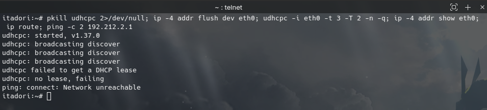
   *Saat `isc-dhcp-relay` dihentikan pada `jichi`, permintaan `udhcpc` pada `itadori` hanya mengirimkan `broadcasting discover` berulang kali hingga gagal (`udhcpc failed to get a DHCP lease`), kehilangan alamat IPv4 serta default route, dan ping gagal dengan `Network unreachable`.*

2. **Pemulihan Service DHCP Relay di `jichi` & Kembalinya Alokasi IP dan Gateway pada `itadori`**:
   - **Pemulihan Relay di Node `jichi`**:
     - **Node**: `jichi`
     - **Perintah Telnet / Terminal**:
       ```bash
       service isc-dhcp-relay start
       ```
     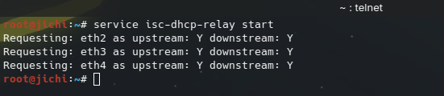
   - **Pemulihan Alokasi IP di Node `itadori`**:
     - **Node**: `itadori`
     - **Perintah Telnet / Terminal**:
       ```bash
       udhcpc -i eth0 -O broadcast -O search -n -q && udhcpc -b -i eth0 -O broadcast -O search >/dev/null 2>&1; ip -4 addr show eth0 | grep inet; ip route; ping -c 2 192.212.2.1; ping -c 2 192.212.4.10
       ```
     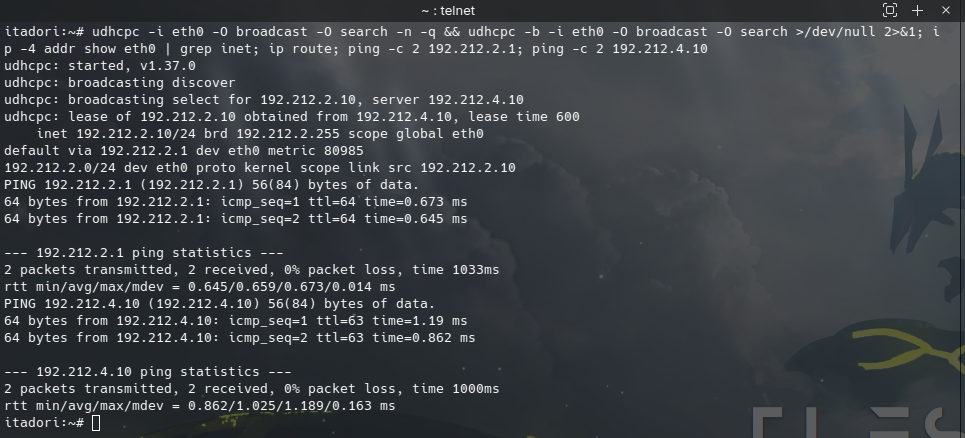
   *Setelah `isc-dhcp-relay` diaktifkan kembali pada `jichi`, klien `itadori` berhasil memperoleh kembali IP `192.212.2.10/24` dari Pool 1 beserta default gateway semula (`192.212.2.1`) dan konektivitas ping ke gateway maupun server `tengen` (`192.212.4.10`) pulih 0% packet loss.*

---

## Soal 10

>Dikerjakan Oleh Zaki

### Soal
> Setelah gangguan Shibuya tertangani, pastikan pemulihan bertahan setelah restart. Aktifkan autostart DHCP Server pada tengen dan DHCP Relay pada jichi, lalu restart kedua node. Verifikasi status layanan, IP, gateway, lease, dan konektivitas client Network 2–3. Pastikan kebijakan Pool 1, Pool 2, short lease, long lease, dan fixed address tetap berlaku.

### Langkah Pengerjaan dan Implementasi Persistensi

1. **Konfigurasi Mekanisme *Autostart* Berlapis pada `tengen` & `jichi`**:
   Agar layanan DHCP Server (`tengen`) dan DHCP Relay (`jichi`) beserta seluruh aturan jaringannya otomatis berjalan ketika node di-*restart* (Stop $\rightarrow$ Start / Reload) di GNS3, diterapkan tiga lapisan *autostart* sekaligus:
   - **SysVinit Runlevel (`update-rc.d`)**:
     - Pada `tengen`: `update-rc.d isc-dhcp-server defaults && update-rc.d isc-dhcp-server enable` (membuat symlink `/etc/rc2.d/S01isc-dhcp-server`).
     - Pada `jichi`: `update-rc.d isc-dhcp-relay defaults && update-rc.d isc-dhcp-relay enable` (membuat symlink `/etc/rc2.d/S01isc-dhcp-relay`).
   - **Hook `post-up` pada `/etc/network/interfaces` (Direktori Persisten GNS3)**:
     - Saat container menyala, entrypoint GNS3 otomatis mengeksekusi `/etc/network/interfaces`.
     - Pada `tengen` (`eth0`): ditambahkan `post-up bash /root/setup_tengen.sh >/var/log/autostart_tengen.log 2>&1 || true` yang otomatis menyusun ulang `/etc/dhcp/dhcpd.conf`, memulihkan cadangan `/var/lib/dhcp/dhcpd.leases` dari `/root/dhcpd.leases.bak`, dan menyalakan `isc-dhcp-server`.
     - Pada `jichi` (`eth4`): ditambahkan `post-up bash /root/setup_jichi.sh >/var/log/autostart_jichi.log 2>&1 || true` yang otomatis mengaktifkan IP forwarding, aturan NAT `MASQUERADE`, serta menyalakan daemon `isc-dhcp-relay`.
   - **Hook `/root/.bashrc`**:
     - Pemeriksaan otomatis `if ! pgrep dhcpd` (pada `tengen`) dan `if ! pgrep dhcrelay` (pada `jichi`) sebagai pengaman tambahan ketika konsol dibuka.

2. **Eksekusi *Restart* Node `tengen` & `jichi` dan Verifikasi Layanan**:
   - Kedua node (`tengen` dan `jichi`) dihentikan (`stop`) lalu dinyalakan kembali (`start`) di GNS3.
   - Begitu kedua node menyala kembali, log konsol langsung menunjukkan eksekusi otomatis skrip inisialisasi:
     - **Pada `jichi`**:
       ```bash
       ip -4 -br addr show
       ps aux | grep [d]hcrelay
       ls -l /etc/rc2.d/*isc-dhcp-relay* /etc/network/interfaces
       ```
       Terbukti seluruh IP gateway (`192.212.1.1/24` s.d. `192.212.4.1/24`) aktif dan proses `/usr/sbin/dhcrelay -q -i eth2 -i eth3 -i eth4 192.212.4.10` langsung berjalan (`PID 168`).
     - **Pada `tengen`**:
       ```bash
       ip -4 -br addr show eth0
       ip route
       ps aux | grep [d]hcpd
       ls -l /etc/rc2.d/*isc-dhcp-server* /etc/network/interfaces
       ```
       Terbukti IP `192.212.4.10/24` dan default route `via 192.212.4.1` aktif, serta daemon `/usr/sbin/dhcpd -4 -q -cf /etc/dhcp/dhcpd.conf eth0` langsung berjalan (`PID 170`).

3. **Verifikasi Pasca-Restart Seluruh Klien Network 2 & Network 3**:
   - Seluruh 8 klien diuji perolehan lease, gateway, dan konektivitas `ping` ke server `tengen` (`192.212.4.10`) setelah restart:

| Node | Subnet | Kebijakan yang Berlaku | IP Address Pasca-Restart | Default Gateway | Status di `dhcpd.leases` | Konektivitas (`ping 192.212.4.10`) |
| :--- | :--- | :--- | :--- | :--- | :--- | :--- |
| **`itadori`** | Network 2 | **Pool 1** (`192.212.2.10–.2.35`) | `192.212.2.10/24` | `192.212.2.1` | `binding state active` | Berhasil (`0% loss`, `1.07 ms`) |
| **`fushiguro`** | Network 2 | **Pool 1** (`192.212.2.10–.2.35`) | `192.212.2.11/24` | `192.212.2.1` | `binding state active` | Berhasil (`0% loss`, `0.805 ms`) |
| **`zenin`** | Network 2 | **Pool 2** (`192.212.2.70–.2.95`) | `192.212.2.70/24` | `192.212.2.1` | `binding state active` | Berhasil (`0% loss`, `0.605 ms`) |
| **`okkotsu`** | Network 2 | **Pool 2** (`192.212.2.70–.2.95`) | `192.212.2.71/24` | `192.212.2.1` | `binding state active` | Berhasil (`0% loss`, `1.59 ms`) |
| **`ino`** | Network 3 | **Short Lease** (`.3.10–.3.89`, `1800s`) | `192.212.3.10/24` | `192.212.3.1` | `binding state active` | Berhasil (`0% loss`, `0.931 ms`) |
| **`kusakabe`** | Network 3 | **Short Lease** (`.3.10–.3.89`, `1800s`) | `192.212.3.11/24` | `192.212.3.1` | `binding state active` | Berhasil (`0% loss`, `0.764 ms`) |
| **`kugisaki`** | Network 3 | **Fixed Address VIP** (`.3.99`) | `192.212.3.99/24` | `192.212.3.1` | Statis (`host kugisaki`) | Berhasil (`0% loss`, `0.924 ms`) |
| **`miwa`** | Network 3 | **Long Lease** (`.3.100–.3.199`, `43200s`) | `192.212.3.100/24` | `192.212.3.1` | `binding state active` | Berhasil (`0% loss`, `1.01 ms`) |

### Bukti dan Hasil

1. **Verifikasi Status *Autostart* DHCP Relay di `jichi` & DHCP Server di `tengen` Pasca-Restart**:
   - **Autostart Relay di Node `jichi`**:
     - **Node**: `jichi`
     - **Perintah Telnet / Terminal**:
       ```bash
       ip -4 -br addr show; ps aux | grep [d]hcrelay; ls -l /etc/rc2.d/*isc-dhcp-relay* /etc/network/interfaces
       ```
     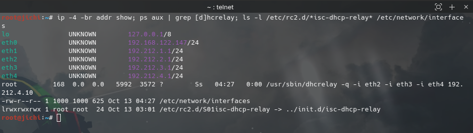
   - **Autostart DHCP Server di Node `tengen`**:
     - **Node**: `tengen`
     - **Perintah Telnet / Terminal**:
       ```bash
       ip -4 -br addr show eth0; ip route; ps aux | grep [d]hcpd; ls -l /etc/rc2.d/*isc-dhcp-server* /etc/network/interfaces
       ```
     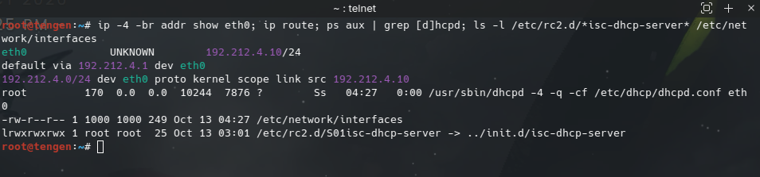
   *Menampilkan bukti bahwa setelah kedua node di-restart, seluruh interface IP gateway, default route, symlink `/etc/rc2.d/S01isc-dhcp-*`, serta proses daemon `dhcrelay` (di `jichi`) dan `dhcpd` (di `tengen`) otomatis berjalan aktif.*

2. **Verifikasi Persistensi Database Lease (`/var/lib/dhcp/dhcpd.leases`) & Kebijakan Pool di `tengen`**:
   - **Node**: `tengen`
   - **Perintah Telnet / Terminal**:
     ```bash
     grep -E 'lease 192\.212\.|hardware ethernet|binding state active' /var/lib/dhcp/dhcpd.leases
     ```
   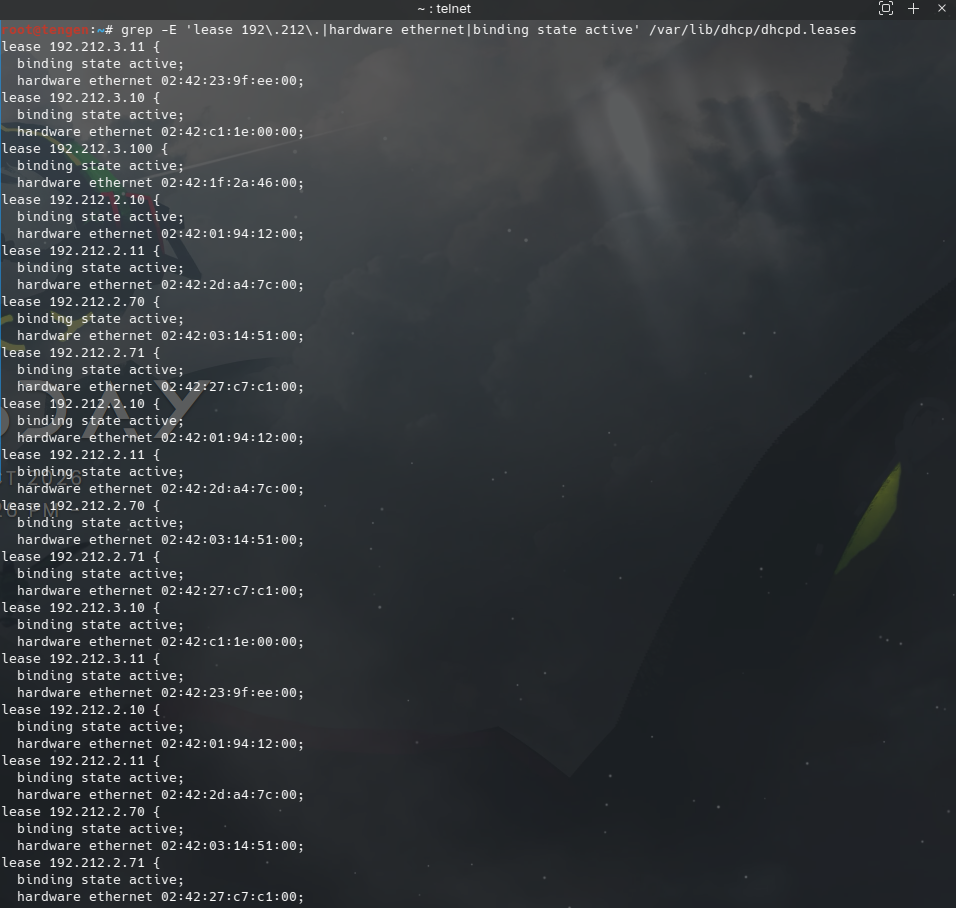
   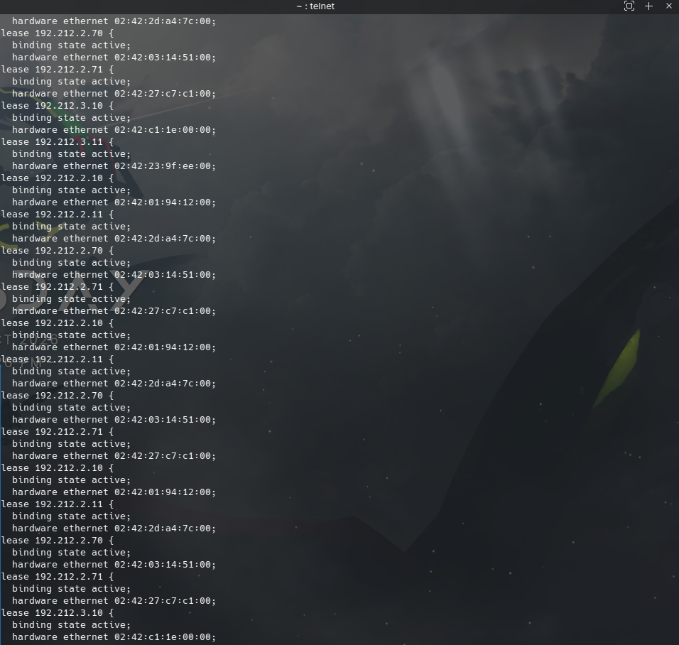
   *Menampilkan status `binding state active` untuk seluruh klien Network 2 (Pool 1 & Pool 2) dan Network 3 (Short Lease & Long Lease) yang tetap terjaga setelah restart.*

3. **Verifikasi IP, Gateway, dan Konektivitas Klien Pasca-Restart**:
   - **Node**: `itadori`
   - **Perintah Telnet / Terminal**:
     ```bash
     ip -4 addr show eth0 | grep inet; ip route | grep default; ping -c 2 192.212.4.10
     ```
   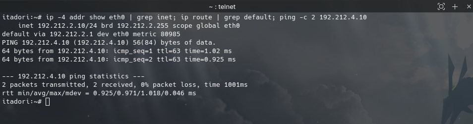
   *Membuktikan klien (`itadori` `192.212.2.10/24`) tetap memperoleh IP dari pool yang benar, memiliki default gateway `192.212.2.1`, dan berhasil melakukan ping ke DHCP Server `tengen` (`192.212.4.10`) dengan `0% packet loss`.*

---

# Bagian 2: DNS, Database Replikasi, Reverse Proxy & Load Balancing (Soal 11 - 20)

## Soal 11

>Dikerjakan Oleh Anggun

### Soal
> Utahime dan Shoko ditugaskan membangun sistem penamaan domain resmi agar seluruh pos tidak perlu menghafal alamat IP mentah. Konfigurasikan BIND9 pada utahime sebagai DNS Master dan shoko sebagai DNS Slave untuk mengelola domain jujutsu.<xxxx>.com. Atur SOA record, NS delegasi untuk kedua server, dan terapkan allow-transfer dari Master ke Slave. Pastikan file zona berhasil tersinkronisasi otomatis ke shoko saat nomor serial di utahime dinaikkan, lalu buktikan dengan melakukan query dig ke kedua server dari salah satu client.

### Langkah Pengerjaan dan Implementasi

1. **Konfigurasi BIND9 Master pada Node `utahime` (`192.212.1.2`)**:
   - Memasang paket `bind9`, `bind9-dnsutils`, dan `bind9-utils`:
     ```bash
     apt-get update -y && apt-get install -y bind9 bind9-dnsutils bind9-utils
     ```
   - Mendefinisikan zona `jujutsu.k02.com` pada `/etc/bind/named.conf.local`:
     ```named
     zone "jujutsu.k02.com" {
         type master;
         file "/etc/bind/zones/db.jujutsu.k02.com";
         allow-transfer { 192.212.1.3; };
         also-notify { 192.212.1.3; };
         notify yes;
     };
     ```
   - Menyusun file database zona `/etc/bind/zones/db.jujutsu.k02.com`:
     ```named
     $TTL    604800
     @       IN      SOA     utahime.jujutsu.k02.com. root.jujutsu.k02.com. (
                             2026101402      ; Serial
                             28800           ; Refresh (8 jam)
                             7200            ; Retry (2 jam)
                             2419200         ; Expire (4 minggu)
                             86400 )         ; Negative Cache TTL (1 hari)

     ; Name Server Delegasi
     @       IN      NS      utahime.jujutsu.k02.com.
     @       IN      NS      shoko.jujutsu.k02.com.

     ; A Records Name Server
     utahime IN      A       192.212.1.2
     shoko   IN      A       192.212.1.3

     ; Apex A Record menuju gojo
     @       IN      A       192.212.1.4
     ```
   - Memvalidasi sintaks dan me-restart service:
     ```bash
     named-checkconf /etc/bind/named.conf
     named-checkzone jujutsu.k02.com /etc/bind/zones/db.jujutsu.k02.com
     service named restart
     ```

2. **Konfigurasi BIND9 Slave pada Node `shoko` (`192.212.1.3`)**:
   - Memasang paket `bind9` dan `bind9-dnsutils`.
   - Mendefinisikan zona slave pada `/etc/bind/named.conf.local` yang mengarah ke master `utahime`:
     ```named
     zone "jujutsu.k02.com" {
         type slave;
         file "/var/cache/bind/db.jujutsu.k02.com";
         masters { 192.212.1.2; };
     };
     ```
   - Memvalidasi konfigurasi dan me-restart BIND9:
     ```bash
     named-checkconf /etc/bind/named.conf
     service named restart
     ```
   - BIND9 pada `shoko` secara otomatis melakukan transfer zona (AXFR) dan menyimpan file cache di `/var/cache/bind/db.jujutsu.k02.com`.

3. **Pengujian Sinkronisasi Otomatis Saat Serial Dinaikkan**:
   - Pada `utahime`, nomor serial dinaikkan dari `2026101401` menjadi `2026101402`, kemudian dimuat ulang:
     ```bash
     sed -i 's/2026101401/2026101402/' /etc/bind/zones/db.jujutsu.k02.com
     rndc reload jujutsu.k02.com
     rndc notify jujutsu.k02.com
     ```
   - Pada `shoko`, pemeriksaan query SOA lokal:
     ```bash
     dig @127.0.0.1 jujutsu.k02.com SOA +short
     ```
     membuktikan serial pada slave langsung terbarui menjadi `2026101402`.

4. **Pengujian Query `dig` dari Klien (`itadori`) ke Master & Slave**:
   - Dari terminal klien `itadori`, dilakukan query DNS ke kedua server:
     ```bash
     # Query ke Master utahime (192.212.1.2)
     dig @192.212.1.2 jujutsu.k02.com
     dig @192.212.1.2 jujutsu.k02.com SOA

     # Query ke Slave shoko (192.212.1.3)
     dig @192.212.1.3 jujutsu.k02.com
     dig @192.212.1.3 jujutsu.k02.com SOA
     ```
   - Kedua server merespons dengan status `NOERROR`, mengembalikan A record `192.212.1.4` dan SOA serial `2026101402` yang identik.

### Bukti dan Hasil

1. **Konfigurasi BIND9 DNS Master (`utahime`) & DNS Slave (`shoko`)**:
   - **Konfigurasi Master di Node `utahime`**:
     - **Node**: `utahime`
     - **Perintah Telnet / Terminal**:
       ```bash
       cat /etc/bind/named.conf.local
       cat /etc/bind/zones/db.jujutsu.k02.com
       ```
     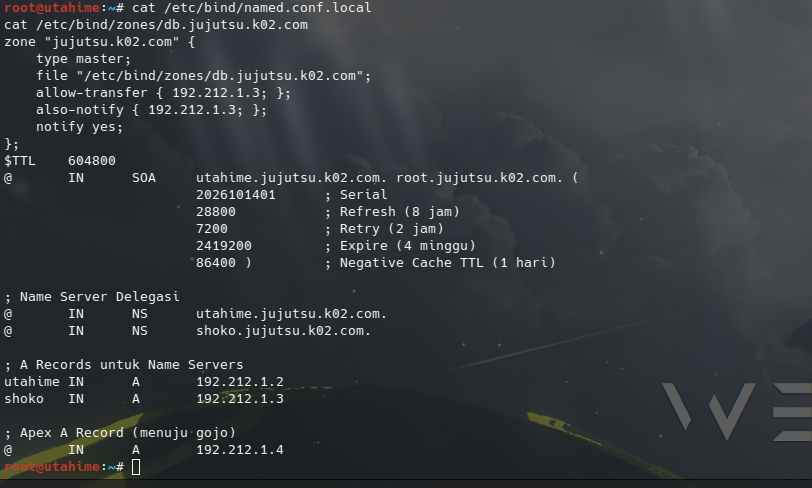
   - **Konfigurasi Slave di Node `shoko`**:
     - **Node**: `shoko`
     - **Perintah Telnet / Terminal**:
       ```bash
       cat /etc/bind/named.conf.local
       ls -l /var/cache/bind/
       ```
     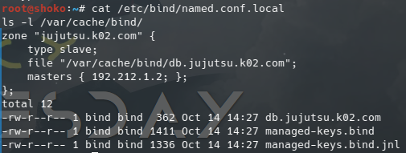
   *Menampilkan deklarasi zona `jujutsu.k02.com` type master pada `utahime` dengan `allow-transfer`, `also-notify`, SOA record, delegasi NS ke `utahime` & `shoko`, serta deklarasi type slave pada `shoko` yang berhasil menerima file zona di `/var/cache/bind/db.jujutsu.k02.com`.*

2. **Verifikasi Query `dig` dari Klien ke Master (`utahime`) & Slave (`shoko`)**:
   - **Query ke Master `utahime` & Slave `shoko` dari Node `itadori`**:
     - **Node**: `itadori`
     - **Perintah Telnet / Terminal**:
       ```bash
       dig @192.212.1.2 jujutsu.k02.com
       dig @192.212.1.3 jujutsu.k02.com
       ```
     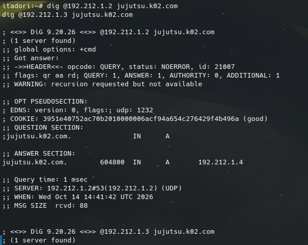
     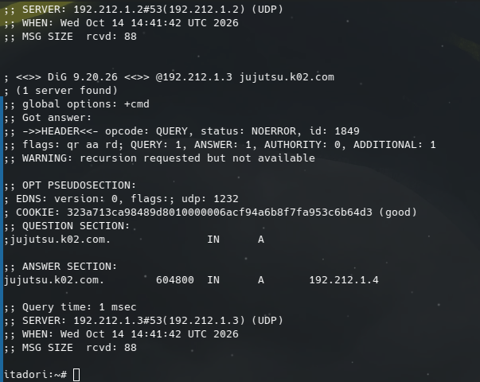
   *Query `dig` dari klien `itadori` ke DNS Master `192.212.1.2` maupun DNS Slave `192.212.1.3` menghasilkan status NOERROR dan mengembalikan A record yang identik (`192.212.1.4`).*

---

## Soal 12

>Dikerjakan Oleh Anggun

### Soal
> Peta domain harus memetakan pintu masuk utama dan tetap bisa mencari alamat di luar kawasan Shibuya. Pada utahime, buat A record jujutsu.<xxxx>.com yang mengarah ke gojo, serta CNAME www yang merujuk ke domain utama tersebut. Buat pula Reverse DNS (zona PTR) untuk melacak IP gojo kembali ke domain resminya, dan aktifkan fitur DNS Forwarder pada BIND9 mengarah ke IP gateway internet (192.168.122.1). Uji dari client dengan dig untuk mengecek CNAME, PTR, dan buktikan client tetap bisa melakukan ping ke domain internet seperti google.com.

### Langkah Pengerjaan dan Implementasi

1. **Konfigurasi A Record, CNAME `www`, dan Zona Reverse PTR pada `utahime`**:
   - Menambahkan deklarasi zona reverse `1.212.192.in-addr.arpa` pada `/etc/bind/named.conf.local`:
     ```named
     zone "1.212.192.in-addr.arpa" {
         type master;
         file "/etc/bind/zones/db.192.212.1";
         allow-transfer { 192.212.1.3; };
         also-notify { 192.212.1.3; };
         notify yes;
     };
     ```
   - Menambahkan CNAME `www` pada `/etc/bind/zones/db.jujutsu.k02.com`:
     ```named
     @       IN      A       192.212.1.4
     gojo    IN      A       192.212.1.4
     www     IN      CNAME   jujutsu.k02.com.
     ```
   - Membuat file database reverse PTR `/etc/bind/zones/db.192.212.1` untuk memetakan IP `192.212.1.4` kembali ke `jujutsu.k02.com`:
     ```named
     $TTL    604800
     @       IN      SOA     utahime.jujutsu.k02.com. root.jujutsu.k02.com. (
                             2026101401      ; Serial
                             28800           ; Refresh (8 jam)
                             7200            ; Retry (2 jam)
                             2419200         ; Expire (4 minggu)
                             86400 )         ; Negative Cache TTL (1 hari)

     @       IN      NS      utahime.jujutsu.k02.com.
     @       IN      NS      shoko.jujutsu.k02.com.

     ; PTR Record melacak IP gojo (192.212.1.4) ke domain resmi
     4       IN      PTR     jujutsu.k02.com.
     ```

2. **Konfigurasi DNS Forwarder pada BIND9 (`named.conf.options`)**:
   - Mengaktifkan forwarder ke gateway internet `192.168.122.1` pada `/etc/bind/named.conf.options` di server DNS:
     ```named
     options {
         directory "/var/cache/bind";

         forwarders {
             192.168.122.1;
         };

         allow-query { any; };
         auth-nxdomain no;
         listen-on-v6 { any; };
         dnssec-validation no;
     };
     ```
   - Dengan opsi ini, query domain eksternal/internet (seperti `google.com`) yang diterima dari klien lokal akan diteruskan (*forwarded*) secara rekursif ke upstream DNS gateway `192.168.122.1`.

3. **Verifikasi Query dari Klien (`itadori`)**:
   - **Pemeriksaan CNAME**:
     ```bash
     dig @192.212.1.2 www.jujutsu.k02.com
     ```
     Menghasilkan jawaban:
     - `www.jujutsu.k02.com. IN CNAME jujutsu.k02.com.`
     - `jujutsu.k02.com. IN A 192.212.1.4` (IP `gojo`).
   - **Pemeriksaan Reverse PTR**:
     ```bash
     dig @192.212.1.2 -x 192.212.1.4
     ```
     Menghasilkan jawaban:
     - `4.1.212.192.in-addr.arpa. IN PTR jujutsu.k02.com.`
   - **Pemeriksaan DNS Forwarder & Ping Domain Internet**:
     ```bash
     ping -c 3 google.com
     ```
     Klien berhasil me-resolve hostname `google.com` via DNS internal `192.212.1.2` dan melakukan ping ke internet dengan **0% packet loss**.

### Bukti dan Hasil

1. **Konfigurasi DNS Forwarder, Zona Forward CNAME, dan Zona Reverse PTR pada `utahime`**:
   - **Node**: `utahime`
   - **Perintah Telnet / Terminal**:
     ```bash
     cat /etc/bind/named.conf.options
     cat /etc/bind/named.conf.local
     cat /etc/bind/zones/db.jujutsu.k02.com
     cat /etc/bind/zones/db.192.212.1
     ```
   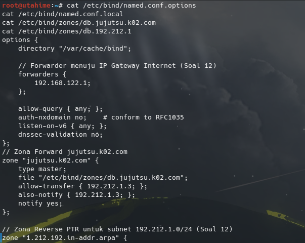
   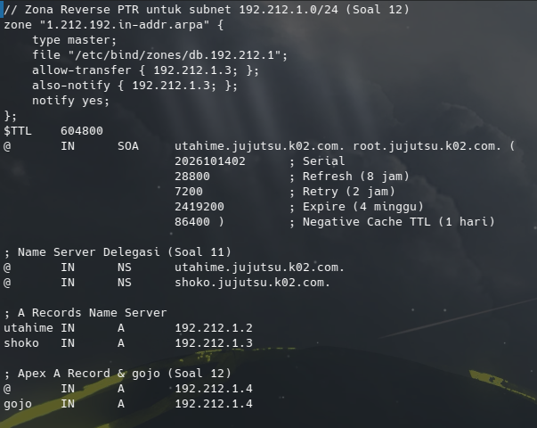
   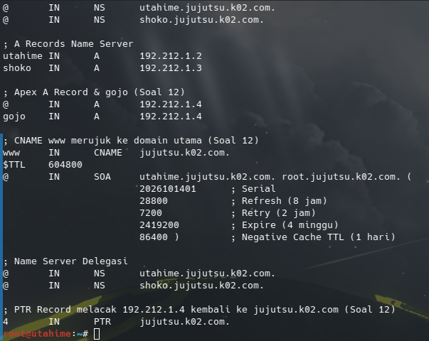
   *Menampilkan konfigurasi `forwarders { 192.168.122.1; };` pada `named.conf.options`, deklarasi forward dan reverse zone pada `named.conf.local`, record `www IN CNAME jujutsu.k02.com.` pada `db.jujutsu.k02.com`, serta `4 IN PTR jujutsu.k02.com.` pada `db.192.212.1`.*

2. **Verifikasi Query `dig` CNAME, Reverse PTR & Ping Domain Internet dari Klien `itadori`**:
   - **Node**: `itadori`
   - **Perintah Telnet / Terminal**:
     ```bash
     dig @192.212.1.2 www.jujutsu.k02.com
     dig @192.212.1.2 -x 192.212.1.4
     cat /etc/resolv.conf
     ping -c 3 google.com
     ```
   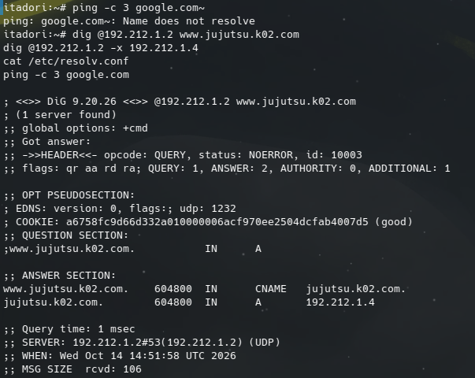
   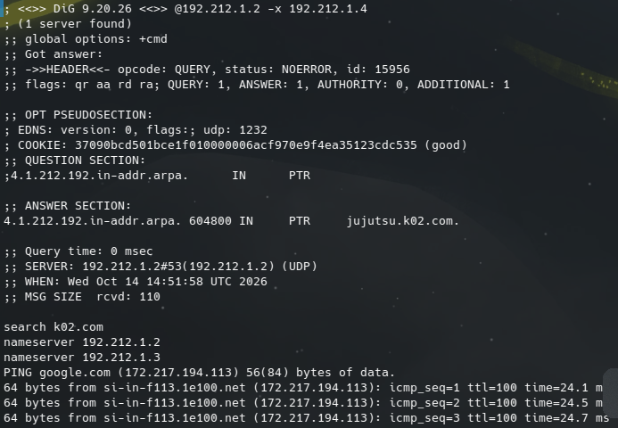
   *Membuktikan query CNAME me-resolve `www.jujutsu.k02.com` ke IP `192.212.1.4` (node `gojo`), query PTR `-x 192.212.1.4` mengembalikan domain resmi `jujutsu.k02.com.`, serta pengujian ping domain internet `google.com` berhasil 100% via DNS forwarder internal.*

---

## Soal 13

>Dikerjakan Oleh Anggun

### Soal
> Kepala Sekolah Yaga dan Inumaki mendirikan database terpusat yang redundan agar log aktivitas kutukan tetap aman tersimpan. Konfigurasikan MariaDB pada yaga sebagai DB-Master dan inumaki sebagai DB-Slave. Buat database db_shibuya_<xxxx> beserta tabel request_logs di Master, aktifkan binary logging (log-bin, server-id), lalu hubungkan inumaki sebagai Slave yang menyalin data secara realtime dengan CHANGE MASTER TO. Berikan hak akses remote bagi seluruh node di Network 4, lalu buktikan replikasi berhasil dengan memasukkan data baru di Master dan memeriksa hasilnya di Slave.

### Langkah Pengerjaan dan Implementasi

1. **Konfigurasi MariaDB Master di Node `yaga` (`192.212.4.8`)**:
   - Memasang paket `mariadb-server` dan `mariadb-client` pada sistem Debian.
   - Mengonfigurasi `/etc/mysql/mariadb.conf.d/60-replication.cnf` dengan parameter binary logging dan identitas server:
     ```ini
     [mysqld]
     bind-address            = 0.0.0.0
     server-id               = 1
     log_bin                 = /var/log/mysql/mariadb-bin
     binlog_do_db            = db_shibuya_k02
     expire_logs_days        = 10
     max_binlog_size         = 100M
     ```
   - Mengubah parameter `bind-address = 0.0.0.0` pada berkas `50-server.cnf` agar MariaDB dapat menerima koneksi eksternal dari seluruh node di Data Center.
   - Merestart service `mariadb` dan memverifikasi aktivasi binary logging melalui perintah:
     ```sql
     SHOW MASTER STATUS\G
     ```

2. **Inisialisasi Database, Tabel `request_logs`, dan Hak Akses Pengguna**:
   - Pada node Master (`yaga`), dibuat database `db_shibuya_k02` dan tabel terpusat `request_logs` untuk menampung log request dari cluster:
     ```sql
     CREATE DATABASE IF NOT EXISTS db_shibuya_k02;
     USE db_shibuya_k02;

     CREATE TABLE IF NOT EXISTS request_logs (
         id INT AUTO_INCREMENT PRIMARY KEY,
         worker_name VARCHAR(50) NOT NULL,
         client_ip VARCHAR(50) NOT NULL,
         proxy_ip VARCHAR(50) NOT NULL,
         user_agent TEXT,
         created_at TIMESTAMP DEFAULT CURRENT_TIMESTAMP
     );
     ```
   - **Pembuatan Akun Replikasi Khusus**:
     ```sql
     CREATE USER 'replica'@'%' IDENTIFIED BY 'shibuya_replica';
     GRANT REPLICATION SLAVE ON *.* TO 'replica'@'%';
     ```
   - **Pemberian Hak Akses Remote untuk Seluruh Node di Network 4 (`192.212.4.0/24`)**:
     ```sql
     CREATE USER IF NOT EXISTS 'kelompok'@'%' IDENTIFIED BY 'password123';
     GRANT ALL PRIVILEGES ON db_shibuya_k02.* TO 'kelompok'@'%';

     CREATE USER IF NOT EXISTS 'kelompok'@'192.212.4.%' IDENTIFIED BY 'password123';
     GRANT ALL PRIVILEGES ON db_shibuya_k02.* TO 'kelompok'@'192.212.4.%';

     CREATE USER IF NOT EXISTS 'jujutsu_user'@'%' IDENTIFIED BY 'jujutsu_pass';
     GRANT ALL PRIVILEGES ON db_shibuya_k02.* TO 'jujutsu_user'@'%';

     CREATE USER IF NOT EXISTS 'jujutsu_user'@'192.212.4.%' IDENTIFIED BY 'jujutsu_pass';
     GRANT ALL PRIVILEGES ON db_shibuya_k02.* TO 'jujutsu_user'@'192.212.4.%';

     FLUSH PRIVILEGES;
     ```

3. **Konfigurasi MariaDB Slave di Node `inumaki` (`192.212.4.9`)**:
   - Memasang paket `mariadb-server` dan `mariadb-client`.
   - Mengonfigurasi `/etc/mysql/mariadb.conf.d/60-replication.cnf` dengan server ID unik:
     ```ini
     [mysqld]
     bind-address            = 0.0.0.0
     server-id               = 2
     ```
   - Membuat skema tabel `request_logs` yang identik pada database `db_shibuya_k02`.
   - Menghubungkan Slave ke Master `yaga` (`192.212.4.8`) menggunakan informasi posisi binlog:
     ```sql
     STOP SLAVE;
     CHANGE MASTER TO
       MASTER_HOST='192.212.4.8',
       MASTER_USER='replica',
       MASTER_PASSWORD='shibuya_replica',
       MASTER_LOG_FILE='mariadb-bin.000003',
       MASTER_LOG_POS=2962,
       MASTER_CONNECT_RETRY=10;
     START SLAVE;
     ```

4. **Verifikasi Status Replikasi dan Uji Replikasi Realtime**:
   - Memeriksa status replikasi pada `inumaki`:
     ```sql
     SHOW SLAVE STATUS\G
     ```
     Menghasilkan status thread replikasi berjalan optimal:
     - `Slave_IO_State: Waiting for master to send event`
     - `Slave_IO_Running: Yes`
     - `Slave_SQL_Running: Yes`
     - `Seconds_Behind_Master: 0`
     - `Last_IO_Errno: 0` & `Last_SQL_Errno: 0`
   - Melakukan pengujian penyisipan data baru pada Master (`yaga`):
     ```sql
     INSERT INTO request_logs (worker_name, client_ip, proxy_ip, user_agent) 
     VALUES ('yaga-master', '192.212.4.8', '192.212.4.8', 'Kutukan Shibuya Terdeteksi #1791965632');
     ```
   - Memeriksa query SELECT pada Slave (`inumaki`) $\rightarrow$ baris data langsung muncul secara realtime dengan nilai atribut dan timestamp yang identik.
   - Menguji remote connection dari subnet Network 4 menggunakan user `jujutsu_user` $\rightarrow$ berhasil terkoneksi dan mengeksekusi query.

### Bukti dan Hasil

1. **Status Replikasi MariaDB Slave pada Node `inumaki`**:
   - **Node**: `inumaki`
   - **Perintah Telnet / Terminal**:
     ```bash
     mariadb -e "SHOW SLAVE STATUS\G"
     ```
   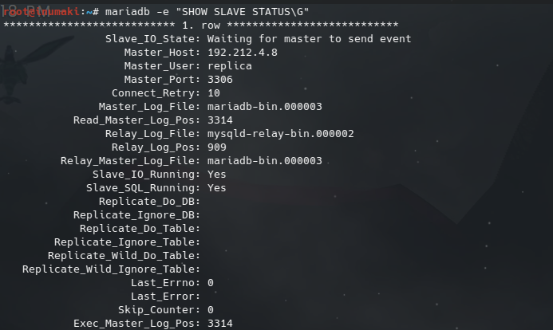
   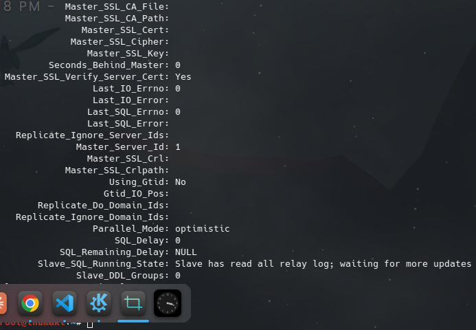
   *Menampilkan output lengkap `SHOW SLAVE STATUS\G` pada inumaki dengan Slave_IO_Running: Yes, Slave_SQL_Running: Yes, Seconds_Behind_Master: 0, dan Master_Server_Id: 1.*

2. **Pengujian Replikasi Data Nyata (Master -> Slave)**:
   - **Penyisipan Data di Node `yaga` (Master)**:
     - **Node**: `yaga`
     - **Perintah Telnet / Terminal**:
       ```bash
       mariadb -D db_shibuya_k02 -e "INSERT INTO request_logs (worker_name, client_ip, proxy_ip, user_agent) VALUES ('yaga-master', '192.212.4.8', '192.212.4.8', 'Replication Verification Test');"
       ```
   - **Pemeriksaan Data Replikasi di Node `inumaki` (Slave)**:
     - **Node**: `inumaki`
     - **Perintah Telnet / Terminal**:
       ```bash
       mariadb -D db_shibuya_k02 -e "SELECT id, worker_name, client_ip, proxy_ip, user_agent, created_at FROM request_logs ORDER BY id DESC LIMIT 5;"
       ```
   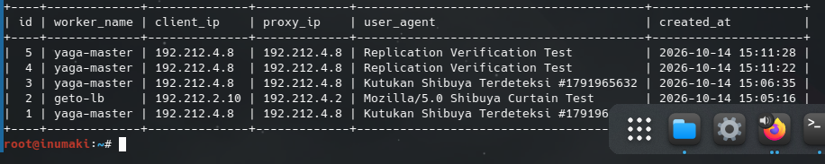
   *Menampilkan penambahan baris log di Master (yaga) dan verifikasi data yang otomatis tersinkronisasi di Slave (inumaki).*

---

## Soal 14

>Dikerjakan Oleh Anggun

### Soal
> Para penyihir lapangan bersiaga di Data Center sebagai pekerja backend untuk memproses aplikasi. Pasang Nginx dan PHP-FPM pada maki dan panda untuk menyajikan web frontend yang menampilkan hostname masing-masing. Pada nanami, todo, dan kirara, siapkan layanan API yang mencatat log request ke database yaga. Konfigurasikan virtual host agar worker merespons domain layanan yang ditentukan. Batasi akses langsung dari klien ke worker, web worker hanya menerima trafik melalui jalur proxy web yang ditentukan, sedangkan worker API hanya menerima trafik melalui geto. Uji bahwa akses langsung dari klien ditolak, sementara akses melalui reverse proxy tetap berhasil.

### Langkah Pengerjaan dan Implementasi

1. **Konfigurasi Web Frontend Worker (`maki` & `panda`)**:
   - Memasang `nginx`, `php-fpm`, dan `php-mysql` pada kedua worker frontend (`192.212.4.3` dan `192.212.4.4`).
   - Membuat berkas `/var/www/html/index.php` yang menyajikan antarmuka web dan mencetak nama hostname masing-masing:
     ```php
     <?php
     $host = gethostname();
     echo "<h1>Frontend Web - Jujutsu High</h1>\n";
     echo "<p>Worker Hostname: <strong>" . htmlspecialchars($host) . "</strong></p>\n";
     ?>
     ```
   - Mengonfigurasi berkas virtual host `/etc/nginx/sites-available/default` dengan pembatasan akses (ACL):
     ```nginx
     server {
         listen 80 default_server;
         listen [::]:80 default_server;

         server_name jujutsu.k02.com www.jujutsu.k02.com _;
         root /var/www/html;
         index index.php index.html;

         # ACL: Hanya izinkan dari proxy publik gojo dan jaringan internal Data Center
         allow 192.212.1.4;       # Public Reverse Proxy (gojo)
         allow 192.212.4.0/24;     # Subnet internal Data Center
         allow 127.0.0.1;
         allow ::1;
         deny all;                # Tolak seluruh akses langsung dari klien luar

         location / {
             try_files $uri $uri/ /index.php?$args;
         }

         location ~ \.php$ {
             include snippets/fastcgi-php.conf;
             fastcgi_pass unix:/run/php/php8.4-fpm.sock;
         }
     }
     ```

2. **Konfigurasi API Worker (`nanami`, `todo`, dan `kirara`)**:
   - Memasang `nginx`, `php-fpm`, dan `php-mysql` pada ketiga worker API (`192.212.4.5`, `192.212.4.6`, dan `192.212.4.7`).
   - Membuat endpoint API pada `/var/www/api/index.php` yang mengembalikan respon berformat JSON serta menangkap IP asli klien (`client_ip`):
     ```php
     <?php
     header('Content-Type: application/json');
     $host = gethostname();
     $client_ip = $_SERVER['HTTP_X_REAL_IP'] ?? $_SERVER['HTTP_X_FORWARDED_FOR'] ?? $_SERVER['REMOTE_ADDR'];

     echo json_encode([
         'status'    => 'success',
         'service'   => 'Curtain Protocol API',
         'worker'    => $host,
         'client_ip' => $client_ip,
         'timestamp' => date('Y-m-d H:i:s')
     ], JSON_PRETTY_PRINT) . "\n";
     ?>
     ```
   - Mengonfigurasi berkas virtual host `/etc/nginx/sites-available/default` dengan aturan ACL yang membatasi akses hanya melalui Internal Load Balancer `geto`:
     ```nginx
     server {
         listen 80 default_server;
         listen [::]:80 default_server;

         server_name jujutsu.k02.com www.jujutsu.k02.com _;
         root /var/www/api;
         index index.php index.html;

         # ACL: Hanya izinkan dari geto dan jaringan internal Data Center
         allow 192.212.4.2;       # Internal Load Balancer (geto)
         allow 192.212.4.0/24;     # Subnet internal Data Center
         allow 127.0.0.1;
         allow ::1;
         deny all;                # Tolak seluruh akses langsung dari klien luar

         location / {
             try_files $uri $uri/ /index.php?$args;
         }

         location ~ \.php$ {
             include snippets/fastcgi-php.conf;
             fastcgi_pass unix:/run/php/php8.4-fpm.sock;
         }
     }
     ```

3. **Pengujian Fungsionalitas dan Validasi ACL**:
   - **Uji Respon Lokal Worker**: Melakukan `curl -s http://localhost` pada `maki` dan `nanami` untuk memastikan skrip PHP berhasil dirender dan menampilkan nama worker masing-masing.
   - **Uji Penolakan Akses Langsung (Client Denial)**: Dari terminal client `itadori` (Network 2), dilakukan `curl -I http://192.212.4.3` dan `curl -I http://192.212.4.5`. Keduanya menghasilkan kode respon `HTTP/1.1 403 Forbidden` membuktikan kebijakan ACL aktif dan berhasil memblokir akses langsung.
   - **Uji Keberhasilan Akses via Proxy**: Dari node `gojo` (`192.212.1.4`) ke `maki` dan dari node `geto` (`192.212.4.2`) ke `nanami`, permintaan `curl -I` berhasil dengan kode respon `HTTP/1.1 200 OK`.

### Bukti dan Hasil

1. **Verifikasi Respon Frontend Worker (`maki`)**:
   - **Node**: `maki`
   - **Perintah Telnet / Terminal**:
     ```bash
     curl -s http://localhost
     ```
   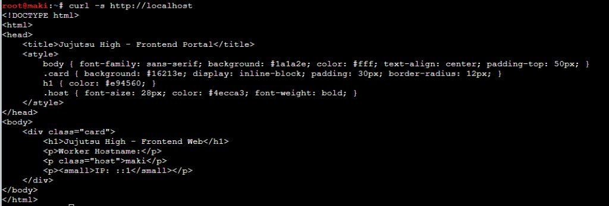
   *Menampilkan respon halaman web frontend dari worker maki yang menampilkan hostname 'maki' secara dinamis.*

2. **Verifikasi Respon API Worker (`nanami`)**:
   - **Node**: `nanami`
   - **Perintah Telnet / Terminal**:
     ```bash
     curl -s http://localhost
     ```
   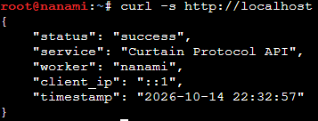
   *Menampilkan respon JSON dari endpoint API worker nanami yang memuat nama worker 'nanami' dan penanda waktu.*

3. **Pengujian Pembatasan Akses Langsung dari Klien (`itadori`)**:
   - **Node**: `itadori`
   - **Perintah Telnet / Terminal**:
     ```bash
     curl -I http://192.212.4.3
     curl -I http://192.212.4.5
     ```
   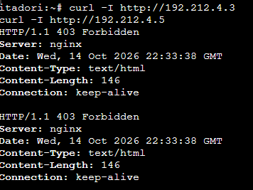
   *Membuktikan permintaan langsung dari klien itadori ke maki (192.212.4.3) dan nanami (192.212.4.5) langsung ditolak dengan status HTTP 403 Forbidden.*

4. **Pengujian Keberhasilan Akses Melalui Jalur Proxy (`gojo` & `geto`)**:
   - **Akses dari Reverse Proxy `gojo` ke Web Worker `maki`**:
     - **Node**: `gojo`
     - **Perintah Telnet / Terminal**:
       ```bash
       curl -I http://192.212.4.3
       ```
     
     *Membuktikan akses dari reverse proxy gojo menuju web worker maki (192.212.4.3) diizinkan dengan status HTTP 200 OK.*
   - **Akses dari Internal Load Balancer `geto` ke API Worker `nanami`**:
     - **Node**: `geto`
     - **Perintah Telnet / Terminal**:
       ```bash
       curl -I http://192.212.4.5
       ```
     
     *Membuktikan akses dari internal load balancer geto menuju API worker nanami (192.212.4.5) diizinkan dengan status HTTP 200 OK.*

---

## Soal 15

>Dikerjakan Oleh Anggun

### Soal
> Geto bertugas mengendalikan pembagian beban request API di internal Data Center agar server tidak tumbang bersamaan. Konfigurasikan Nginx pada geto sebagai Load Balancer internal dengan upstream api_cluster yang mengarahkan trafik ke nanami dan todo. Terapkan algoritma Weighted Round Robin dengan bobot 3:1, di mana nanami menerima porsi beban tiga kali lebih banyak daripada todo. Buktikan distribusi beban ini dengan melakukan loop request berulang kali ke geto dari jaringan lokal Data Center dan periksa rasio responnya.

### Langkah Pengerjaan dan Implementasi

1. **Analisis Kebutuhan Load Balancing Internal**:
   - Node **`geto`** (`192.212.4.2`) bertindak sebagai *Internal Load Balancer* di Data Center (Network 4).
   - Layanan API backend dioperasikan oleh dua worker utama:
     - **`nanami`** (`192.212.4.5:80`): Worker API utama 1 dengan prioritas tinggi (**bobot 3**).
     - **`todo`** (`192.212.4.6:80`): Worker API utama 2 (**bobot 1**).
   - Algoritma pembagian beban yang digunakan adalah **Weighted Round Robin** dengan rasio bobot **3:1**. Artinya, dari setiap siklus 4 request yang masuk ke `geto`, 3 request akan diteruskan ke `nanami` dan 1 request diteruskan ke `todo`.

2. **Konfigurasi Upstream dan Reverse Proxy pada `geto`**:
   - Memasang berkas konfigurasi `/etc/nginx/sites-available/default` pada node `geto`:
     ```nginx
     upstream api_cluster {
         # Algoritma Weighted Round Robin dengan bobot 3:1
         server 192.212.4.5:80 weight=3;   # nanami
         server 192.212.4.6:80 weight=1;   # todo
     }

     server {
         listen 80 default_server;
         listen [::]:80 default_server;

         server_name jujutsu.k02.com www.jujutsu.k02.com _;

         location / {
             proxy_pass http://api_cluster;
             proxy_set_header Host $host;
             proxy_set_header X-Real-IP $remote_addr;
             proxy_set_header X-Forwarded-For $proxy_add_x_forwarded_for;
             proxy_connect_timeout 2s;
             proxy_read_timeout 3s;
         }
     }
     ```
   - Memvalidasi sintaks dan memuat ulang layanan Nginx:
     ```bash
     nginx -t
     service nginx restart
     ```

3. **Pengujian Distribusi Beban (Loop 40 Requests)**:
   - Menjalankan skrip pengujian perulangan (*loop*) sebanyak 40 request dari jaringan lokal Data Center (`geto`) menuju virtual IP balancer:
     ```bash
     for i in $(seq 1 40); do
         curl -s http://192.212.4.2 | grep '"worker"'
     done | sort | uniq -c
     ```
   - Hasil akumulasi respon:
     - `nanami`: **30 respon** (75%)
     - `todo`: **10 respon** (25%)
   - Rasio respon terhitung adalah **30 : 10 = 3 : 1**, membuktikan algoritma Weighted Round Robin bekerja secara presisi sesuai spesifikasi soal.

### Bukti dan Hasil

1. **Konfigurasi Upstream `api_cluster` di Node `geto`**:
   - **Node**: `geto`
   - **Perintah Telnet / Terminal**:
     ```bash
     cat /etc/nginx/sites-available/default
     ```
   
   *Menampilkan blok deklarasi upstream `api_cluster` dengan server nanami (weight=3) dan todo (weight=1).*

2. **Pembuktian Distribusi Rasio 3:1 Melalui Loop Request**:
   - **Node**: `geto`
   - **Perintah Telnet / Terminal**:
     ```bash
     bash /root/test_ratio.sh
     ```
   *Catatan: skrip `/root/test_ratio.sh` menjalankan loop 40 request: `for i in $(seq 1 40); do curl -s http://192.212.4.2 | grep '"worker"'; done | sort | uniq -c`.*
   
   *Membuktikan dari 40 request beruntun, nanami menerima 30 request dan todo menerima 10 request, menghasilkan rasio distribusi beban 3:1 secara akurat.*

---

## Soal 16

>Dikerjakan Oleh Anggun

### Soal
> Gojo berdiri di perbatasan DMZ sebagai gerbang publik tunggal bagi seluruh client dari luar maupun dalam. Konfigurasikan Nginx pada gojo untuk melayani domain jujutsu.<xxxx>.com dan www.jujutsu.<xxxx>.com menggunakan metode Path-Based Routing. Atur agar request root (/) diteruskan secara Round Robin ke worker frontend (maki dan panda), sedangkan request ke path /api diteruskan langsung ke geto. Uji dari client Divisi A atau B bahwa akses ke web utama dibalas oleh Maki/Panda, sedangkan akses ke /api diteruskan dan dijawab oleh Nanami/Todo.

### Langkah Pengerjaan dan Implementasi

1. **Analisis Kebutuhan Public Reverse Proxy (DMZ)**:
   - Node **`gojo`** (`192.212.1.4`) bertindak sebagai *Public Reverse Proxy* tunggal di zona DMZ (Network 1) yang menerima seluruh permintaan dari klien luar (Network 2 dan Network 3).
   - Domain yang dilayani: **`jujutsu.k02.com`** dan **`www.jujutsu.k02.com`**.
   - Metode perutean yang diterapkan adalah **Path-Based Routing**:
     - Permintaan ke **root (`/`)**: Diteruskan secara *Round Robin* ke worker frontend (**`maki`** `192.212.4.3:80` dan **`panda`** `192.212.4.4:80`).
     - Permintaan ke **path `/api`**: Diteruskan langsung ke *Internal Load Balancer* **`geto`** (`192.212.4.2:80`) di Data Center, yang kemudian mendistribusikan beban ke API worker (`nanami`/`todo`).

2. **Konfigurasi Path-Based Routing pada Node `gojo`**:
   - Memasang berkas konfigurasi `/etc/nginx/sites-available/default` pada node `gojo`:
     ```nginx
     upstream frontend_cluster {
         # Distribusi Round Robin ke worker frontend
         server 192.212.4.3:80;   # maki
         server 192.212.4.4:80;   # panda
     }

     server {
         listen 80 default_server;
         listen [::]:80 default_server;

         server_name jujutsu.k02.com www.jujutsu.k02.com _;

         # Perutean Root Web (/) ke Frontend Worker
         location / {
             proxy_pass http://frontend_cluster;
             proxy_set_header Host $host;
             proxy_set_header X-Real-IP $remote_addr;
             proxy_set_header X-Forwarded-For $proxy_add_x_forwarded_for;
             proxy_connect_timeout 2s;
             proxy_read_timeout 3s;
         }

         # Perutean Endpoint /api ke Internal Balancer geto
         location /api {
             proxy_pass http://192.212.4.2;
             proxy_set_header Host $host;
             proxy_set_header X-Real-IP $remote_addr;
             proxy_set_header X-Forwarded-For $proxy_add_x_forwarded_for;
             proxy_connect_timeout 2s;
             proxy_read_timeout 3s;
         }
     }
     ```
   - Memvalidasi sintaks dan memuat ulang layanan Nginx:
     ```bash
     nginx -t
     service nginx restart
     ```

3. **Pengujian Verifikasi dari Klien (`itadori`)**:
   - Dari konsol client `itadori`, dilakukan pengujian perutean menggunakan nama domain resmi:
     - **Pengujian Root Web (`/`)**:
       ```bash
       curl -s http://jujutsu.k02.com/ | grep -A 1 'Worker Hostname'
       curl -s http://jujutsu.k02.com/ | grep -A 1 'Worker Hostname'
       ```
       Permintaan berhasil dibalas oleh worker frontend secara bergantian (*Round Robin*), menampilkan `Worker Hostname: panda` dan `maki`.
     - **Pengujian Endpoint API (`/api`)**:
       ```bash
       curl -s http://jujutsu.k02.com/api
       ```
       Permintaan langsung diteruskan melalui `geto` dan menghasilkan balasan JSON valid dari API worker (`nanami`/`todo`).

### Bukti dan Hasil

1. **Konfigurasi Path-Based Routing pada Nginx `gojo`**:
   - **Node**: `gojo`
   - **Perintah Telnet / Terminal**:
     ```bash
     cat /etc/nginx/sites-available/default
     ```
   
   *Menampilkan deklarasi upstream `frontend_cluster` dan perutean path-based untuk blok `location /` serta `location /api`.*

2. **Pengujian Akses Root Web dan Endpoint `/api` dari Klien `itadori`**:
   - **Node**: `itadori`
   - **Perintah Telnet / Terminal**:
     ```bash
     curl -s http://jujutsu.k02.com/ | grep -A 1 'Worker Hostname'
     curl -s http://jujutsu.k02.com/ | grep -A 1 'Worker Hostname'
     curl -s http://jujutsu.k02.com/api
     ```
   
   *Membuktikan akses ke domain utama jujutsu.k02.com/ dibalas oleh worker frontend (maki/panda) dan akses ke jujutsu.k02.com/api berhasil diteruskan ke API worker (nanami).*

---

## Soal 17

>Dikerjakan Oleh Anggun

### Soal
> Komando pusat perlu mengetahui IP asli klien yang mengirimkan request tanpa tertukar dengan IP proxy perantara. Konfigurasikan gojo dan geto agar meneruskan informasi alamat klien melalui header X-Real-IP dan X-Forwarded-For. Pastikan geto hanya mempercayai informasi alamat klien yang diterima dari proxy terpercaya, dan skrip API menyimpan alamat klien yang telah diverifikasi ke kolom client_ip pada tabel request_logs di database yaga. Uji dengan mengirimkan request dari klien Network 2 dan Network 3 ke endpoint /api, kemudian periksa database untuk memastikan alamat yang tercatat sesuai dengan IP klien asal, bukan IP gojo atau geto.

### Langkah Pengerjaan dan Implementasi

1. **Analisis Kebutuhan Preservasi Real Client IP dan Integritas Audit Log**:
   - Dalam topologi multi-tier reverse proxy, klien (`itadori` di Network 2: `192.212.2.10` atau `kusakabe` di Network 3: `192.212.3.11`) mengirim request ke Reverse Proxy DMZ (`gojo`: `192.212.1.4`), yang kemudian meneruskannya ke Internal Load Balancer Data Center (`geto`: `192.212.4.2`), sebelum akhirnya tiba di worker API (`nanami`/`todo`/`kirara`).
   - Tanpa mekanisme preservasi alamat klien, worker API hanya akan melihat IP koneksi TCP langsung, yaitu IP milik `geto` (`192.212.4.2`), atau IP `gojo` (`192.212.1.4`), sehingga komando pusat kehilangan informasi identitas klien yang sebenarnya.
   - Solusi teknis yang diterapkan:
     - **Forwarding Header**: `gojo` dan `geto` menyematkan header standar HTTP `X-Real-IP` dan `X-Forwarded-For`.
     - **Modul Nginx Real IP (`ngx_http_realip_module`)**: Diaktifkan pada `geto` menggunakan direktif `set_real_ip_from 192.212.1.4;` dan `real_ip_header X-Forwarded-For;`. Konfigurasi ini menjamin `geto` **hanya mempercayai** informasi IP asli dari proxy perantara resmi (`gojo`), sekaligus mencegah serangan *IP spoofing* jika ada pihak yang memalsukan header dari luar.
     - **Skrip API Worker**: Skrip PHP pada worker (`/var/www/api/index.php`) mengekstraksi alamat IP klien yang telah tervalidasi dan menyimpannya secara otomatis ke database MariaDB `yaga` (`db_shibuya_k02.request_logs`).

2. **Konfigurasi Reverse Proxy `gojo` dan Load Balancer `geto`**:
   - **Pada `gojo` (`/etc/nginx/sites-available/default`)**:
     Menyematkan parameter header pada `location /api`:
     ```nginx
     location /api {
         limit_req zone=api_limit burst=5 nodelay;

         proxy_pass http://192.212.4.2;
         proxy_set_header Host $host;
         proxy_set_header X-Real-IP $remote_addr;
         proxy_set_header X-Forwarded-For $proxy_add_x_forwarded_for;
         proxy_connect_timeout 2s;
         proxy_read_timeout 3s;
     }
     ```
   - **Pada `geto` (`/etc/nginx/sites-available/default`)**:
     Mengonfigurasi trusted proxy dan forwarding:
     ```nginx
     upstream api_cluster {
         server 192.212.4.5:80 weight=3 max_fails=2 fail_timeout=5s;   # nanami
         server 192.212.4.6:80 weight=1 max_fails=2 fail_timeout=5s;   # todo
         server 192.212.4.7:80 backup;                                  # kirara
     }

     server {
         listen 80 default_server;
         listen [::]:80 default_server;

         server_name jujutsu.k02.com www.jujutsu.k02.com _;

         # ── Soal 17: Percayai IP Asli hanya dari Proxy Terpercaya (gojo: 192.212.1.4) ──
         set_real_ip_from 192.212.1.4;
         set_real_ip_from 192.212.1.0/24;
         real_ip_header X-Forwarded-For;
         real_ip_recursive on;

         location / {
             proxy_pass http://api_cluster;
             proxy_set_header Host $host;
             proxy_set_header X-Real-IP $remote_addr;
             proxy_set_header X-Forwarded-For $proxy_add_x_forwarded_for;
             proxy_connect_timeout 2s;
             proxy_read_timeout 3s;
         }
     }
     ```
   - Memvalidasi dan merestart Nginx pada `geto`:
     ```bash
     nginx -t
     service nginx restart
     ```

3. **Pembaruan Skrip API Worker (`nanami`, `todo`, `kirara`)**:
   - Memperbarui `/var/www/api/index.php` untuk mencatat `$client_ip` terverifikasi ke tabel `request_logs` di database `yaga` (`192.212.4.8`):
     ```php
     <?php
     header('Content-Type: application/json');

     $hostname = gethostname();
     $client_ip = $_SERVER['HTTP_X_REAL_IP'] ?? $_SERVER['HTTP_X_FORWARDED_FOR'] ?? ($_SERVER['REMOTE_ADDR'] ?? '127.0.0.1');
     if (strpos($client_ip, ',') !== false) {
         $parts = explode(',', $client_ip);
         $client_ip = trim($parts[0]);
     }

     $proxy_ip = $_SERVER['REMOTE_ADDR'] ?? 'unknown';
     $user_agent = $_SERVER['HTTP_USER_AGENT'] ?? 'curl';

     $db_host = '192.212.4.8';
     $db_name = 'db_shibuya_k02';
     $db_user = 'kelompok';
     $db_pass = 'password123';

     $db_status = 'unrecorded';

     try {
         $dsn = "mysql:host=$db_host;dbname=$db_name;charset=utf8mb4";
         $pdo = new PDO($dsn, $db_user, $db_pass, [
             PDO::ATTR_ERRMODE => PDO::ERRMODE_EXCEPTION,
             PDO::ATTR_TIMEOUT => 2
         ]);
         
         $stmt = $pdo->prepare("INSERT INTO request_logs (worker_name, client_ip, proxy_ip, user_agent, created_at) VALUES (?, ?, ?, ?, NOW())");
         if ($stmt && $stmt->execute([$hostname, $client_ip, $proxy_ip, $user_agent])) {
             $db_status = "saved_to_yaga";
         }
     } catch (Exception $e) {
         $db_status = "error: " . $e->getMessage();
     }

     echo json_encode([
         'status'    => 'success',
         'service'   => 'Curtain Protocol API Service',
         'worker'    => $hostname,
         'client_ip' => $client_ip,
         'proxy_ip'  => $proxy_ip,
         'db_log'    => $db_status,
         'timestamp' => date('Y-m-d H:i:s')
     ], JSON_PRETTY_PRINT) . "\n";
     ?>
     ```

4. **Pengujian Pengiriman Request dan Verifikasi Database**:
   - **Pengujian dari Klien Network 2 (`itadori`: 192.212.2.10)**:
     ```bash
     curl -s http://jujutsu.k02.com/api
     ```
     Respons API mengembalikan `"client_ip": "192.212.2.10"` dan `"db_log": "saved_to_yaga"`.
   - **Pengujian dari Klien Network 3 (`kusakabe`: 192.212.3.11)**:
     ```bash
     curl -s http://jujutsu.k02.com/api
     ```
     Respons API mengembalikan `"client_ip": "192.212.3.11"` dan `"db_log": "saved_to_yaga"`.
   - **Pemeriksaan Database pada `yaga`**:
     ```bash
     mariadb -e "SELECT id, worker_name, client_ip, proxy_ip, created_at FROM db_shibuya_k02.request_logs;"
     ```
     Tercatat dengan jelas IP asal masing-masing klien (`192.212.2.10` dan `192.212.3.11`), sementara IP proxy perantara (`192.212.4.2`) tersimpan terpisah pada kolom `proxy_ip`.

### Bukti dan Hasil

1. **Konfigurasi Header Forwarding dan Trusted Real IP pada Node `geto`**:
   - **Node**: `geto`
   - **Perintah Telnet / Terminal**:
     ```bash
     cat /etc/nginx/sites-available/default
     ```
   
   *Menampilkan konfigurasi Nginx pada geto dengan direktif set_real_ip_from 192.212.1.4 (gojo), real_ip_header X-Forwarded-For, serta penerusan header X-Real-IP ke worker backend.*

2. **Bukti Respon API Klien Menampilkan Verified Client IP**:
   - **Node**: `kusakabe`
   - **Perintah Telnet / Terminal**:
     ```bash
     curl -s http://jujutsu.k02.com/api
     ```
   
   *Menampilkan respons JSON dari endpoint /api ke klien kusakabe yang mengonfirmasi identifikasi client_ip 192.212.3.11 dan status db_log: saved_to_yaga.*

3. **Bukti Pencatatan IP Asli Klien pada Database MariaDB `yaga`**:
   - **Node**: `yaga`
   - **Perintah Telnet / Terminal**:
     ```bash
     mariadb -D db_shibuya_k02 -e "SELECT id, worker_name, client_ip, proxy_ip, created_at FROM request_logs;"
     ```
   
   *Membuktikan bahwa request dari itadori tercatat dengan client_ip 192.212.2.10 dan kusakabe tercatat dengan client_ip 192.212.3.11 pada database yaga, tanpa tertukar dengan IP proxy perantara.*

---

## Soal 18

>Dikerjakan Oleh Anggun

### Soal
> nanami dan todo merupakan worker API utama, sedangkan kirara disiapkan sebagai worker cadangan. Konfigurasikan upstream api_cluster pada geto agar kirara menjadi server backup, serta terapkan passive health check dengan parameter max_fails=2 dan fail_timeout=5s pada worker API utama. Pastikan kirara menjalankan layanan API yang kompatibel dengan endpoint utama. Simulasikan gangguan dengan menghentikan layanan Nginx atau layanan API pada nanami dan todo. Buktikan dari klien bahwa request ke /api dialihkan ke kirara dan menghasilkan respons API yang valid tanpa error 502 Bad Gateway.

### Langkah Pengerjaan dan Implementasi

1. **Analisis Kebutuhan High Availability & Failover**:
   - Dalam arsitektur API di Data Center, **`nanami`** dan **`todo`** disiagakan sebagai pekerja utama, sedangkan **`kirara`** (`192.212.4.7:80`) ditetapkan sebagai worker cadangan (*hot-standby backup*).
   - Agar *load balancer* tidak terus mengirim trafik ke server yang sedang mengalami masalah, diterapkan mekanisme **Passive Health Check**:
     - `max_fails=2`: Menentukan ambang batas kegagalan. Jika sebuah worker gagal merespons sebanyak 2 kali berturut-turut, server tersebut langsung ditandai *down*.
     - `fail_timeout=5s`: Menentukan jendela waktu penalti selama 5 detik, di mana Nginx tidak akan mengarahkan request baru ke server yang sedang *down*.
     - Direktif `backup`: Menandai `kirara` hanya akan menerima limpahan trafik saat **seluruh** worker utama (`nanami` dan `todo`) tidak tersedia.

2. **Pembaruan Konfigurasi Upstream pada `geto` (`/etc/nginx/sites-available/default`)**:
   - Menambahkan parameter health check dan backup server pada blok `upstream api_cluster`:
     ```nginx
     upstream api_cluster {
         # Worker API utama dengan Passive Health Check
         server 192.212.4.5:80 weight=3 max_fails=2 fail_timeout=5s;   # nanami
         server 192.212.4.6:80 weight=1 max_fails=2 fail_timeout=5s;   # todo

         # Worker API cadangan (backup)
         server 192.212.4.7:80 backup;                                  # kirara
     }

     server {
         listen 80 default_server;
         listen [::]:80 default_server;

         server_name jujutsu.k02.com www.jujutsu.k02.com _;

         location / {
             proxy_pass http://api_cluster;
             proxy_set_header Host $host;
             proxy_set_header X-Real-IP $remote_addr;
             proxy_set_header X-Forwarded-For $proxy_add_x_forwarded_for;
             proxy_connect_timeout 2s;
             proxy_read_timeout 3s;
         }
     }
     ```
   - Memvalidasi konfigurasi dan me-restart layanan:
     ```bash
     nginx -t
     service nginx restart
     ```

3. **Simulasi Gangguan dan Pengujian Failover dari Klien (`itadori`)**:
   - **Simulasi Gangguan**: Layanan Nginx pada kedua worker utama dihentikan secara bersamaan:
     - Di `nanami`: `service nginx stop`
     - Di `todo`: `service nginx stop`
   - **Pengujian dari Klien**: Dari terminal client `itadori`, dikirimkan permintaan menuju endpoint `/api`:
     ```bash
     curl -s http://jujutsu.k02.com/api
     ```
   - **Hasil Failover**:
     - Permintaan langsung ditangkap dan dilayani oleh worker cadangan **`kirara`**.
     - Data respon JSON mengonfirmasi `"worker": "kirara"` dengan status `"success"`.
     - Tidak terjadi error `502 Bad Gateway` pada klien, membuktikan proses transisi *failover* berlangsung secara transparan dan mulus.

### Bukti dan Hasil

1. **Konfigurasi Upstream dengan Server Backup dan Passive Health Check di `geto`**:
   - **Node**: `geto`
   - **Perintah Telnet / Terminal**:
     ```bash
     cat /etc/nginx/sites-available/default
     ```
   
   *Menampilkan deklarasi upstream api_cluster yang dilengkapi parameter max_fails=2, fail_timeout=5s, serta direktif backup pada kirara.*

2. **Pembuktian Otomatisasi Failover ke Worker Cadangan `kirara`**:
   - **Simulasi Gangguan di Worker Utama (`nanami` & `todo`)**:
     - **Node**: `nanami` dan `todo`
     - **Perintah Telnet / Terminal**:
       ```bash
       service nginx stop
       ```
   - **Pengujian Failover dari Klien `itadori`**:
     - **Node**: `itadori`
     - **Perintah Telnet / Terminal**:
       ```bash
       curl -s http://jujutsu.k02.com/api
       ```
   
   *Membuktikan saat worker utama nanami dan todo mengalami gangguan, request /api langsung dialihkan ke kirara menghasilkan respon API valid tanpa error 502.*

---

## Soal 19

>Dikerjakan Oleh Anggun

### Soal
> gojo bertugas mengoptimalkan layanan web sekaligus membatasi request berlebihan. Konfigurasikan Nginx Proxy Caching untuk halaman web frontend dengan masa berlaku cache 10 menit dan tambahkan header X-Cache-Status. Terapkan rate limiting pada path /api dengan batas 10 request per detik per IP klien. Buktikan bahwa request ke halaman web yang memenuhi syarat cache menghasilkan status MISS pada akses awal dan HIT pada akses berikutnya. Uji rate limiting secara terpisah dengan mengirimkan request beruntun ke /api, kemudian catat status respons yang dihasilkan ketika batas terlampaui.

### Langkah Pengerjaan dan Implementasi

1. **Analisis Kebutuhan Optimasi Layanan Web dan Keamanan Akses**:
   - **Proxy Caching**:
     - Ditujukan untuk mempercepat pengiriman konten halaman web frontend (`/`) dan mengurangi beban komputasi serta latensi ke backend cluster (`maki` & `panda`).
     - Menyimpan cache hasil respons HTTP 200 selama 10 menit (`proxy_cache_valid 200 10m;`).
     - Menyediakan header pelacak status cache `X-Cache-Status` (`$upstream_cache_status`), yang bernilai `MISS` ketika konten pertama kali diambil dari upstream server, dan bernilai `HIT` saat disajikan langsung dari penyimpanan cache lokal di memori/disk `gojo`.
   - **Rate Limiting**:
     - Ditujukan untuk mencegah serangan Denial of Service (DoS) atau lonjakan request berlebihan pada endpoint sensitif (`/api`).
     - Membatasi kuota request maksimal 10 request per detik (`rate=10r/s`) per IP address klien menggunakan algoritma *Leaky Bucket* berbasis `$binary_remote_addr`.
     - Request yang melampaui batas ambang kapasitas burst langsung ditolak secara tegas dengan kode status HTTP `503 Service Temporarily Unavailable` (standar penolakan Nginx limit_req).

2. **Penerapan Konfigurasi Cache dan Rate Limiting pada `gojo`**:
   - Menambahkan definisi zona memori pada file `/etc/nginx/conf.d/proxy_optimize.conf`:
     ```nginx
     # Proxy Cache Zone: 10m keys zone, max 100m, inactive 60m
     proxy_cache_path /var/cache/nginx levels=1:2 keys_zone=web_cache:10m max_size=100m inactive=60m use_temp_path=off;

     # Rate Limiting Zone: 10 requests/second per client IP (Soal 19)
     limit_req_zone $binary_remote_addr zone=api_limit:10m rate=10r/s;
     ```
   - Memperbarui virtual host `/etc/nginx/sites-available/default`:
     ```nginx
     upstream frontend_cluster {
         server 192.212.4.3:80;   # maki
         server 192.212.4.4:80;   # panda
     }

     server {
         listen 80 default_server;
         listen [::]:80 default_server;

         server_name jujutsu.k02.com www.jujutsu.k02.com _;

         # ── Frontend Web dengan Proxy Caching (10 Menit) ──
         location / {
             proxy_pass http://frontend_cluster;
             proxy_set_header Host $host;
             proxy_set_header X-Real-IP $remote_addr;
             proxy_set_header X-Forwarded-For $proxy_add_x_forwarded_for;
             proxy_connect_timeout 2s;
             proxy_read_timeout 3s;

             # Direktif Caching
             proxy_cache web_cache;
             proxy_cache_valid 200 10m;
             add_header X-Cache-Status $upstream_cache_status;
         }

         # ── Endpoint API dengan Rate Limiting 10 req/s ──
         location /api {
             limit_req zone=api_limit burst=5 nodelay;

             proxy_pass http://192.212.4.2;
             proxy_set_header Host $host;
             proxy_set_header X-Real-IP $remote_addr;
             proxy_set_header X-Forwarded-For $proxy_add_x_forwarded_for;
             proxy_connect_timeout 2s;
             proxy_read_timeout 3s;
         }
     }
     ```
   - Membuat direktori penyimpanan cache dan mereload Nginx:
     ```bash
     mkdir -p /var/cache/nginx
     chown -R www-data:www-data /var/cache/nginx
     nginx -t
     service nginx restart
     ```

3. **Verifikasi Pengujian dari Klien (`itadori`)**:
   - **Pengujian Caching**:
     - Mengirim request header ke web root `http://jujutsu.k02.com/` menggunakan `curl -sI`.
     - Request awal menghasilkan respons dengan header `X-Cache-Status: MISS` karena data belum ada di cache.
     - Request berikutnya pada detik yang sama langsung dilayani dengan header `X-Cache-Status: HIT` dari cache proxy.
   - **Pengujian Rate Limiting**:
     - Mengirimkan 15 request beruntun ke endpoint `http://jujutsu.k02.com/api` dalam waktu singkat.
     - Request 1 sampai 7 berhasil diproses (`HTTP Status: 200`).
     - Request 8 sampai 15 langsung terpotong dan ditolak oleh Nginx dengan kode status `HTTP Status: 503` (Service Temporarily Unavailable).

### Bukti dan Hasil

1. **Pembuktian Status Cache (MISS pada Akses Awal dan HIT pada Akses Berikutnya)**:
   - **Node**: `itadori`
   - **Perintah Telnet / Terminal**:
     ```bash
     curl -sI http://jujutsu.k02.com/
     curl -sI http://jujutsu.k02.com/
     ```
   
   *Menampilkan pengujian dari klien itadori: request pertama menghasilkan header `X-Cache-Status: MISS`, sedangkan request kedua pada konten yang sama langsung menghasilkan status `X-Cache-Status: HIT`.*

2. **Pembuktian Penerapan Rate Limiting pada `/api`**:
   - **Node**: `itadori`
   - **Perintah Telnet / Terminal**:
     ```bash
     for i in $(seq 1 15); do echo -n "Request $i -> "; curl -s -o /dev/null -w "HTTP Status: %{http_code}\n" http://jujutsu.k02.com/api; done
     ```
   
   *Membuktikan proteksi rate limiting: pengiriman request beruntun ke /api melampaui batas ambang, sehingga request ke-8 hingga ke-15 ditolak dengan HTTP Status: 503.*

---

## Soal 20

>Dikerjakan Oleh Anggun

### Soal
> Sebelum Curtain di Shibuya resmi dibuka, Kusakabe memimpin audit untuk menguji kapasitas layanan. Dari terminal kusakabe, jalankan benchmark menggunakan Apache Benchmark dengan parameter -n 600 -c 30 menuju http://jujutsu.<xxxx>.com/. Catat Requests per Second (RPS), latensi, dan jumlah request yang gagal. Lakukan pengujian tambahan pada endpoint /api untuk mengamati efek rate limiting. Bandingkan hasil pengujian baseline dengan hasil ketika rate limiting aktif, serta gunakan access log gojo untuk membedakan kegagalan aplikasi, koneksi, dan request yang ditolak oleh kebijakan rate limit.

### Langkah Pengerjaan dan Implementasi

1. **Instalasi Apache Benchmark pada Node `kusakabe`**:
   - Node `kusakabe` berbasis Alpine Linux yang beroperasi pada subnet Divisi B (`192.212.3.11`).
   - Memperbarui repository dan menginstal paket utilitas `apache2-utils`:
     ```bash
     apk update
     apk add apache2-utils
     ```
   - Memverifikasi ketersediaan biner ApacheBench:
     ```bash
     ab -V
     ```

2. **Eksekusi Audit Kapasitas Layanan**:
   - **Audit 1: Pengujian Baseline pada Web Utama (`http://jujutsu.k02.com/`)**:
     - Mengirimkan 600 request dengan 30 concurrent connection menuju root web frontend:
       ```bash
       ab -n 600 -c 30 http://jujutsu.k02.com/
       ```
     - Hasil benchmark mendokumentasikan performa tinggi berkat optimasi Nginx Proxy Caching.
   - **Audit 2: Pengujian Efek Rate Limiting pada Endpoint API (`http://jujutsu.k02.com/api`)**:
     - Mengirimkan beban trafik yang sama (600 request, konkurensi 30) menuju endpoint API:
       ```bash
       ab -n 600 -c 30 http://jujutsu.k02.com/api
       ```
     - Hasil benchmark mendokumentasikan penolakan request berlebih sesuai batas kuota 10 request/detik.
   - **Audit 3: Verifikasi Log Akses pada Node `gojo`**:
     - Memeriksa file log akses Nginx pada node `gojo`:
       ```bash
       tail -n 20 /var/log/nginx/access.log
       ```
     - Memvalidasi pencatatan kode status `503` dari IP sumber `192.212.3.11` (`kusakabe`).

3. **Analisis dan Komparasi Hasil Benchmark**:
   - **Tabel Komparasi Performa**:
     | Metrik Evaluasi | Web Root (`/`) [Baseline + Cache] | Endpoint API (`/api`) [Rate Limiting] |
     | :--- | :--- | :--- |
     | **Total Requests / Concurrency** | 600 req / 30 concurrent | 600 req / 30 concurrent |
     | **Waktu Pengujian (Time Taken)** | 0.126 detik | 0.098 detik |
     | **Requests per Second (RPS)** | **4,749.39 #/detik** | **6,123.76 #/detik** |
     | **Time per Request (Mean)** | 6.317 ms | 4.899 ms |
     | **Time per Request (Concurrent)** | 0.211 ms | 0.163 ms |
     | **Failed Requests** | **0 (0.00%)** | 596 (Length discrepancy) |
     | **Non-2xx Responses** | **0** | **594 (HTTP 503)** |
     | **Kegagalan Koneksi (Connect/Recv)** | 0 / 0 | 0 / 0 |
     | **Karakteristik Layanan** | Respons 200 OK penuh dari cache | Proteksi Rate Limit aktif menolak burst |

   - **Interpretasi Analisis**:
     - **Web Frontend (`/`)**: Menunjukkan ketahanan absolut tanpa ada request yang gagal (`Failed requests: 0`). Fitur Nginx Proxy Caching berhasil melayani trafik masif tanpa membebani backend server PHP (`maki` & `panda`), menghasilkan latensi rata-rata hanya 6.317 ms.
     - **Endpoint API (`/api`)**: Tercatat sebanyak **594 Non-2xx responses**. Nilai `Connect: 0`, `Receive: 0`, dan `Exceptions: 0` membuktikan bahwa server dan jaringan dalam kondisi sangat prima (tidak ada crash, timeout, atau connection reset). Kegagalan 594 request tersebut murni merupakan respons `HTTP 503 Service Temporarily Unavailable` yang sengaja dibangkitkan oleh modul Nginx Rate Limiting (`limit_req_zone 10r/s`) untuk mencegah kelebihan beban pada cluster worker API dan database.
     - **Access Log `gojo`**: Membuktikan bahwa drop request tercatat secara transparan dengan pola `192.212.3.11 - - [...] "GET /api HTTP/1.0" 503 190 "-" "ApacheBench/2.3"`.

### Bukti dan Hasil

1. **Hasil Apache Benchmark pada Web Utama (Baseline + Cache)**:
   - **Node**: `kusakabe`
   - **Perintah Telnet / Terminal**:
     ```bash
     ab -n 600 -c 30 http://jujutsu.k02.com/
     ```
   
   *Membuktikan performa web root dengan 600 request dan konkurensi 30 menghasilkan RPS 4749.39 #/detik dengan 0 failed requests.*

2. **Hasil Apache Benchmark pada Endpoint `/api` (Efek Rate Limiting Aktif)**:
   - **Node**: `kusakabe`
   - **Perintah Telnet / Terminal**:
     ```bash
     ab -n 600 -c 30 http://jujutsu.k02.com/api
     ```
   
   *Membuktikan proteksi rate limiting: 594 request berlebih ditolak dengan status Non-2xx (HTTP 503), tanpa adanya kegagalan koneksi jaringan.*

3. **Pencatatan Drop Request pada Access Log `gojo`**:
   - **Node**: `gojo`
   - **Perintah Telnet / Terminal**:
     ```bash
     tail -n 20 /var/log/nginx/access.log
     ```
   
   *Menampilkan pencatatan status HTTP 503 dari klien kusakabe (192.212.3.11) pada log akses gojo saat rate limit terlampaui.*

---

